<p align="right"><a href="README.md">English</a> · <a href="README.ru.md">Русский</a> · <b>Қазақша</b></p>

<p align="center">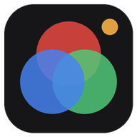</p>

<h1 align="center">GradeStream</h1>

<p align="center"><b>DaVinci Resolve-тағы Clean Feed-ті клиенттің телефонына сілтеме арқылы тарату. Көрерменге ештеңе орнатудың қажеті жоқ.</b><br>
Колористер мен монтажшыларға арналған: грейдті қашықтағы сессияда немесе бөлмедегілердің бәріне көрсетіп, ескертулерді тікелей кадрдағы белгілер түрінде алыңыз.</p>

<p align="center">Windows 10/11 · тегін · ашық код (MIT) · English / Русский / Қазақша<br>
<a href="https://github.com/ushtozhish/gradestream/actions/workflows/build-and-measure.yml"></a><br>
<a href="https://github.com/ushtozhish/gradestream/releases/latest"><b>⬇ Орнатқышты жүктеу</b></a><br><br>
<a href="#️-бауырша-қолда"></a></p>

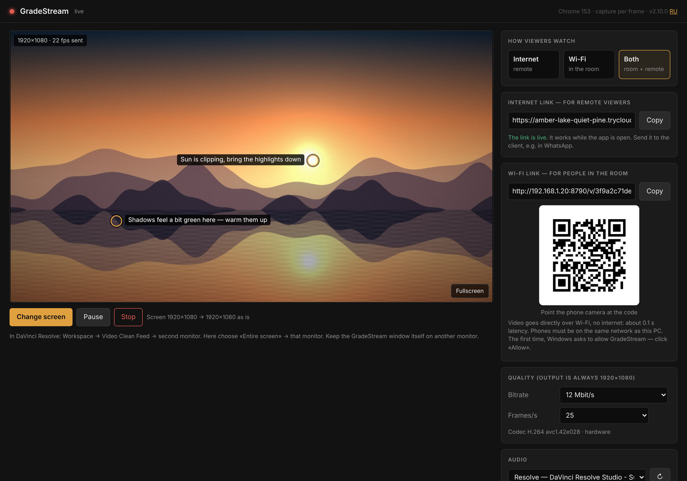

<p align="center">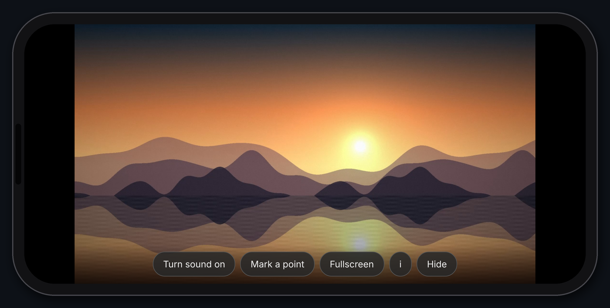<br>
<sub>Клиент көретіні — Safari немесе Chrome-да ашылған жай сілтеме.</sub></p>

> Скриншоттар тест стендіндегі нақты интерфейстен түсірілген. Ондағы сілтемелер, дыбыс құрылғылары, мониторлар және көрермендер тізімі — мысал ретінде; сурет — түпнұсқа синтетикалық кадр. Скриншоттардағы интерфейс ағылшынша, бағдарламада оны қазақ немесе орыс тіліне ауыстыруға болады.

## Мазмұны

- [Неге GradeStream](#неге-gradestream)
- [Монтажды қашықтан қарау: дыбыс синхронды, сурет біркелкі](#монтажды-қашықтан-қарау-дыбыс-синхронды-сурет-біркелкі)
- [Бағдарламаға шолу](#бағдарламаға-шолу)
  - [1. Басқару терезесі](#1-басқару-терезесі) · [2. Интернет, Wi-Fi немесе екеуі бірге](#2-интернет-wi-fi-немесе-екеуі-бірге) · [3. Сілтемелер және QR коды](#3-сілтемелер-және-qr-коды) · [4. 1920×1080 немесе тік бейнелер үшін 1080×1920](#4-19201080-немесе-тік-бейнелер-үшін-10801920) · [5. Сапа](#5-сапа) · [6. Дыбыс](#6-дыбыс) · [7. Клиент не көреді](#7-клиент-не-көреді) ([iPhone-дағы толық экран](#iphone-дағы-толық-экран)) · [8. Клиенттегі скоптар](#8-клиенттегі-скоптар) · [9. Клиент белгілері](#9-клиент-белгілері) · [10. Белгі скриншоттары және пікірлер жиынтығы](#10-белгі-скриншоттары-және-пікірлер-жиынтығы) · [11. Көрермендер](#11-көрермендер) · [12. Науадағы белгіше, тіл, жабу](#12-науадағы-белгіше-тіл-жабу)
- [Баптаулар анықтамалығы](#баптаулар-анықтамалығы)
- [Қалай жұмыс істейді](#қалай-жұмыс-істейді) · [Техникалық сипаттамалар](#техникалық-сипаттамалар) · [Түс: неге сенуге болады, неге болмайды](#түс-неге-сенуге-болады-неге-болмайды)
- [Орнату](#орнату) · [Жылдам бастау](#жылдам-бастау) · [Қауіпсіздік және құпиялылық](#қауіпсіздік-және-құпиялылық) · [Бастапқы кодтан құрастыру](#бастапқы-кодтан-құрастыру) · [Шектеулер](#шектеулер) · [Бауырша қолда](#️-бауырша-қолда)

## Неге GradeStream

- **Клиентке ештеңе керек емес.** WhatsApp немесе Zoom қоңырауы кезінде телефонда ашылған бір сілтеме. Қолданбасыз, аккаунтсыз, плагинсіз.
- **Грейдті тапсыруға арналған.** Кіріс — Clean Feed мониторы, шығыс — түс белгіленген 1920×1080 сурет (тік бейнелер үшін 1080×1920); декодер сол арқылы Resolve беретін RGB мәндерін дәл қалпына келтіреді ([өлшенді](#түс-неге-сенуге-болады-неге-болмайды): орташа ΔE2000 0,22).
- **Ескертулер — тікелей кадрда.** Клиент суретті түртіп, пікір жазады; сіз белгіні өз Clean Feed мониторыңыздың үстінен көресіз, ал әңгіме болып отырған кадрдың дәл өзінің скриншоты пікірмен бірге сақталады.
- **Қашықтан немесе бір бөлмеде.** Интернет арқылы (Cloudflare Tunnel), тікелей Wi-Fi арқылы мүлде интернетсіз — немесе екі тәсіл бірге.
- **Монтажды қарауға да.** «Біркелкі және синхронды» режимі дыбысты суретпен синхронды, ал кадрларды біркелкі ұстайды, сондықтан қашықтағы режиссер монтаж түйіндері мен ырғақты бағалай алады ([өлшенді](#монтажды-қашықтан-қарау-дыбыс-синхронды-сурет-біркелкі)).

## Монтажды қашықтан қарау: дыбыс синхронды, сурет біркелкі

Режиссер немесе продюсер монтажды қашықтан дыбыспен көре алады: сілтемені ашып, дыбыс плиткасын басады, ал GradeStream-де **Көрсету → Біркелкі және синхронды** таңдалады.

**Қалай жұмыс істейді.** Әр кадр және дыбыстың әр 20 мс-і бір сағат бойынша түсірілу сәтімен белгіленеді (дыбыс — Windows дыбыс қозғалтқышы беретін уақыт белгілері бойынша, бейне — түсіру сәті бойынша). Көрерменнің телефоны деректер қандай кешігумен және шашыраумен келетінін бағалап, бәрін *түсіру + бірдей кідіріс* сәтінде көрсетеді:

- дыбыс пен сурет үшін **бірдей кідіріс** → олар сәйкес келеді;
- **желі шашырауына арналған буфер** (0,12–0,7 с, өзі бейімделеді) → кадрлар біркелкі жүреді, желі монтаж ырғағын бұзбайды;
- Wi-Fi арқылы дәл осыны браузердегі кіріктірілген WebRTC синхрондауы жасайды — жіберушінің түсіру сағаты бар есептері бойынша.

**Өлшенді** (тест стенді: басқару терезесі әр секундтың басында ақ болып жарқ етеді, сол сәтте тест сигналының бипі естіледі; көрерменнің телефоны жарқыл қашан көрсетілгенін және бип дыбыс шығысына қашан жеткенін жазады; тұрақсыз желі әр хабарламаны 0–120 мс кешіктіру арқылы имитацияланады):

| | Дыбыс суретке қатысты (минус = дыбыс ерте) | 25 кадр/с кезіндегі кадрлардың біркелкілігі* |
|---|---|---|
| Интернет, «Біркелкі және синхронды», шашыраусыз | медиана −13…+17 мс, оқиғалар −64…+29 мс | ауытқу, медиана 9 мс |
| Интернет, «Біркелкі және синхронды», шашырау 0–120 мс | медиана −12…−16 мс, оқиғалар −66…+1 мс | ауытқу, медиана 8–10 мс, аралықтардың **19%**-ы 60 мс-тан ұзақ |
| Интернет, «Ең аз кідіріс», шашырау 0–120 мс | — (дыбыссыз) | ауытқу, медиана 25–27 мс, аралықтардың **33–36%**-ы 60 мс-тан ұзақ |
| Wi-Fi (WebRTC), «Біркелкі және синхронды» | −4…−11 мс (браузер бағасы**) | көздегідей |
| Wi-Fi (WebRTC), «Ең аз кідіріс» | +17…+27 мс (браузер бағасы**) | көздегідей |

<sub>* Көрсету аралықтарының 40 мс-тан ауытқуы. Бұл стендте шашыраусыз да аралықтардың 14–15%-ы 60 мс-тан ұзақ — синтетикалық көз бен 60 Гц экранға байланысты, сондықтан шашырау кезіндегі 19% осы шекке жақын, ал «Ең аз кідіріс» оны екі есеге арттырады. ** WebRTC статистикасындағы `estimatedPlayoutTimestamp`, жарқыл мен бип бойынша өлшеу емес.</sub>

Салыстыру үшін: ITU-R BT.1359 бойынша *байқалу* шегі — дыбыстың шамамен 45 мс озуы және 125 мс қалуы. Жоғарыдағы барлық медианалар осы шекке сыяды. Өлшеулер GitHub-та әр өзгеріс кезінде автоматты түрде орындалады — соңғы нәтижелер [Actions → Build and measure](https://github.com/ushtozhish/gradestream/actions/workflows/build-and-measure.yml) бетінде (іске қосу жиынтығы).

**Неге жарайды:** монтажды, ырғақты, актерлер ойынын, синхронды, музыкалық түйіндерді, қаралама және таза жинақты бағалау; бірнеше адам бір уақытта көріп, кадрларға белгі қояды.

**Неге жарамайды:**

- **Кадр бойынша дәл ойнату емес.** GradeStream экранды түсіреді. Монитор жиілігі таймлайн жиілігіне еселі болмаса (мысалы, 60 Гц мониторда 23,976/24p таймлайн), біркелкісіздік (pulldown 3:2) мониторда-ақ бар, ағын оны мұраға алады. Ең біркелкі қозғалыс үшін Clean Feed мониторына таймлайнға еселі жиілік қойыңыз (24p үшін 48/72/120 Гц, 25p үшін 50/100 Гц), ал GradeStream-де таймлайнның кадр жиілігін таңдаңыз.
- **Соңғы дыбыс араластыруын бағалауға емес.** 128–192 кбит/с Opus таза естіледі, бірақ телефон динамигі мен құлаққап — дыбыс араластыру студиясы емес.
- **Нақты уақыттағы бірлескен жұмыс емес.** Көрермендер көріп, пікір қалдырады; монтаж сіздің компьютеріңізде жүреді.
- **Синхрондау буфері кідіріс қосады.** «Біркелкі және синхронды» режимінде көрермендер суретті «Ең аз кідіріске» қарағанда 0,12–0,7 с кешірек көреді. Тірі түс түзету үшін «Ең аз кідірісті» қалдырыңыз.
- **Нақты желіде өлшенбеген.** Жоғарыда — 0–120 мс шашырауды имитациялау. Нашар мобильді байланыста TCP жоғалтуларынан кідірістер болады; буферден ұзақ үзілістер бәрібір қатып қалу ретінде көрінеді.

2.11-ге дейінгі нұсқаларда дыбыс пен сурет синхрондаусыз, бір-біріне тәуелсіз жүрді, дыбыс суреттен қалып отырды.

## Бағдарламаға шолу

### 1. Басқару терезесі

Басқару терезесі GradeStream іске қосылғанда ашылады. Үлкен алдын ала көрініс **клиент алатынның дәл өзін** көрсетеді — кесу мен масштабтаудан кейінгі 1920×1080 (немесе 1080×1920) кадр. Клиент белгілері де осында пайда болады.

- **Экранды таңдау** — қай мониторды (немесе терезені) тарату. «Бүкіл экран» → Clean Feed мониторын таңдаңыз.
- **Кідірту** — трансляцияны тоқтатып қояды, клиентте соңғы кадр қалады. **Тоқтату** трансляцияны аяқтайды.
- **Толық экран** (немесе алдын ала көріністі екі рет басу) — алдын ала көріністі үлкейтеді.
- Жоғарғы жол күйді (эфирде / кідіртілді / трансляция жоқ), браузер қозғалтқышы мен түсіру тәсілін, нұсқаны және **EN | RU | KZ** тіл ауыстырғышын көрсетеді.

### 2. Интернет, Wi-Fi немесе екеуі бірге

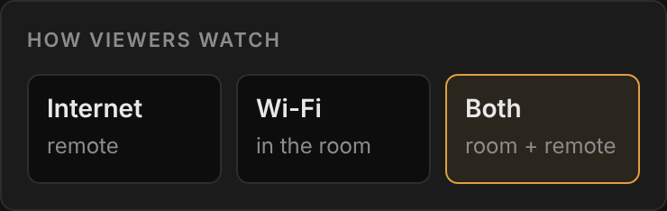

| Режим | Кімге | Сигнал қалай жүреді | Күтілетін кідіріс* |
|---|---|---|---|
| **Интернет** | басқа қаладағы клиент | Cloudflare Tunnel (HTTPS) | жақсы байланыста ≈0,2–0,5 с |
| **Wi-Fi** | бір бөлмедегілердің бәрі | жергілікті желі арқылы тікелей WebRTC; интернет керек емес | ≈0,1–0,25 с |
| **Екеуі бірге** | бөлме және қашықтағы көрермендер | екі тәсіл бірге; әр кадр бір рет кодталады | жоғарыдағыдай |

<sub>* Стендтегі өлшеулер бойынша баға плюс желінің әдеттегі кідірісі — [Кідіріс](#кідіріс) бөлімін қараңыз.</sub>

Режимді ауыстыру көрермендерді тек амалсыз жағдайда ажыратады (мысалы, «Екеуі бірге»-ден «Wi-Fi»-ға ауысу интернеттегі көрермендерді ажыратады), бағдарлама алдымен сұрайды.

<br clear="right">

### 3. Сілтемелер және QR коды

<table><tr>
<td width="50%" valign="top">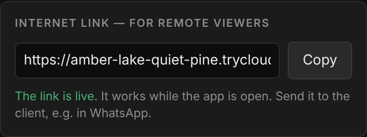<br><b>Интернет сілтемесі</b> — кездейсоқ <code>https://…trycloudflare.com/v/…</code> мекенжайы. Көшіріп, клиентке жіберіңіз. Бағдарлама ашық тұрғанда жұмыс істейді және әр іске қосқанда өзгереді.</td>
<td width="50%" valign="top">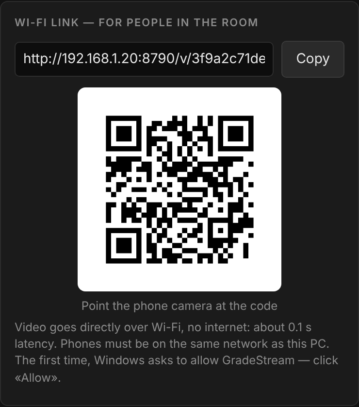<br><b>Wi-Fi сілтемесі</b> — QR коды бар <code>http://&lt;компьютер IP&gt;:8790/v/…</code>. Компьютерде бірнеше желі адаптері болса, телефондар қосылған Wi-Fi желісінің мекенжайын таңдаңыз.</td>
</tr></table>

QR кодты толық экранға шығару үшін оны басыңыз — адамдар отырған бөлмеге ыңғайлы:

<p align="center">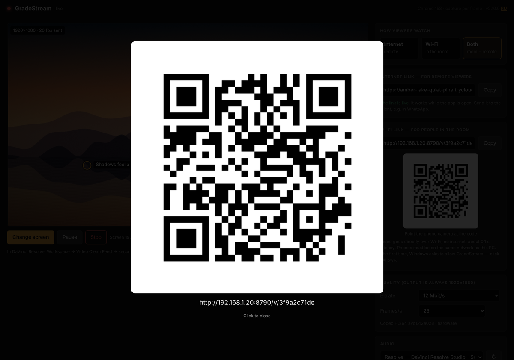</p>

### 4. 1920×1080 немесе тік бейнелер үшін 1080×1920

Клиент 1920×1080 кадр алады. Егер Windows-та Clean Feed мониторы **тік** бағдарда тұрса (Reels, Shorts, TikTok үшін тік монтаж), кадр **1080×1920** болады — қалғанының бәрі бірдей жұмыс істейді: белгілер, олардың скриншоттары, Clean Feed үстіндегі белгілер, скоптар. Монитор 1080p болмаса, GradeStream суретті қалай келтіру керектігін сұрайды және жауапты осы ажыратымдылық үшін есте сақтайды (кейін өзгерту — алдын ала көріністің астындағы **өзгерту**).

<p align="center">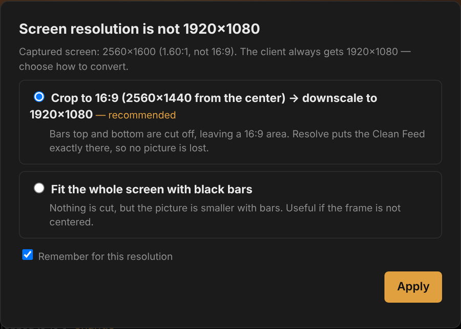</p>

| Сіздің мониторыңыз | Нұсқалар (★ ұсынылады) |
|---|---|
| 1920×1080 | өзгеріссіз |
| 4K, 1440p және басқа 16:9 | ★ 1920×1080-ге дейін кішірейту · ортадан 1:1 кесу (пиксельге пиксель, түйіршік пен шуды тексеру үшін) |
| 720p және одан кіші, 16:9 | ★ 1920×1080-ге дейін үлкейту |
| 1920×1200 | ★ жоғарыдан және төменнен 60 px жолақтарды кесу (Resolve ол жерге 16:9 Clean Feed-ті ортаға қояды) · жолақтармен сыйдыру |
| 2560×1600, ультракең және басқалар | ★ ортадан 16:9-ға дейін кесу → 1920×1080-ге масштабтау · жолақтармен сыйдыру |
| 1080×1920 (тік бағдар) | өзгеріссіз, тік кадр |
| 2160×3840 және басқа 9:16 | ★ 1080×1920-ға дейін кішірейту · ортадан 1:1 кесу |
| 1200×1920 және басқа тік | ★ ортадан 9:16-ға дейін кесу · жолақтармен сыйдыру |

Телефонда тік кадр телефонды тік ұстағанда бүкіл экранды алады; телефонды бұрсаңыз, кадр ортада тұрады. Скоптар ашық болғанда кадр өз бағанасын (телефон көлденең) немесе экранның жоғарғы бөлігін (тік) алады:

| Телефон көлденең | Телефон тік |
|---|---|
| 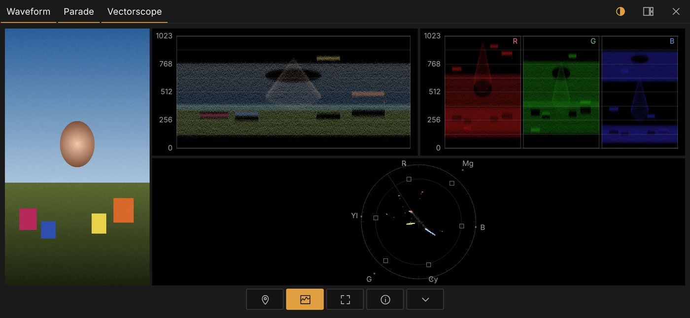 | 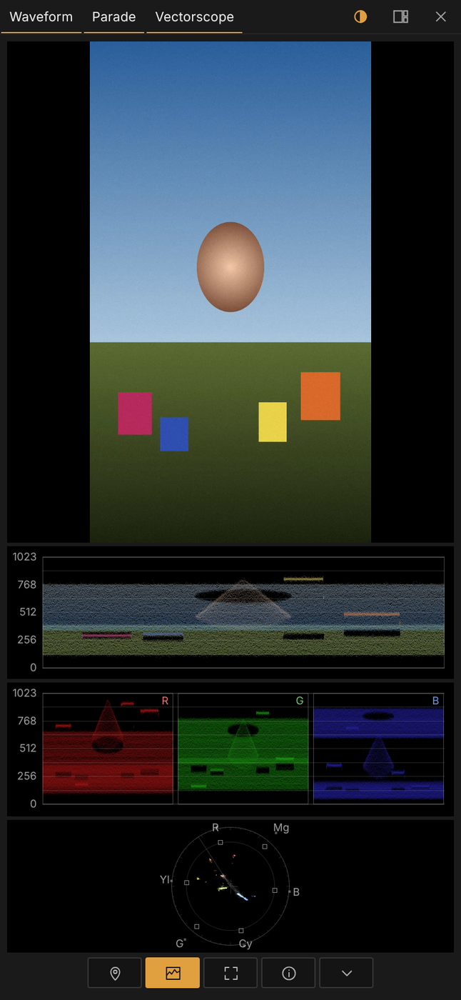 |

### 5. Сапа

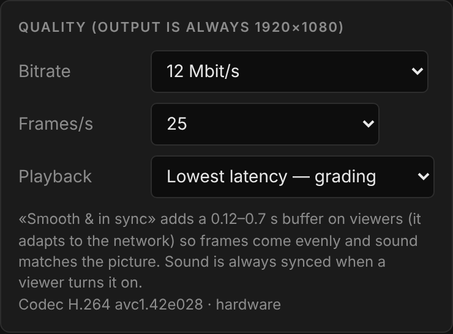

- **Битрейт** — 4 / 8 / 12 / 16 / 24 Мбит/с. Телефонға 8–12 жарайды; 4 — әлсіз байланыс үшін, 16–24 — градиенттер мен ұсақ деталь маңызды әрі желі мүмкіндік бергенде.
- **Кадр/с** — 12 / 24 / 25 / 30 / 50 / 60. 12 кадр/с кезінде әр кадр 25-ке қарағанда шамамен екі есе көп дерек алады: сіз реттегіштерді бұрап отырғанда көлеңкелер мен градиенттер тазарақ, бірақ қозғалыс секірмелірек. Жүріп бара жатқанда өзгертіледі.
- **Көрсету** — **Ең аз кідіріс** (әдепкі, түс түзету үшін: кадр келген бойда көрсетіледі) немесе **Біркелкі және синхронды** (монтажды қарау үшін: 0,12–0,7 с буфер, біркелкі кадрлар, дыбыс синхронды). Көрермен дыбысты қосса, синхрондау әрқашан қосылады.
- **Клиенттегі скоптар** — рұқсат етілген немесе өшірулі ([толығырақ](#8-клиенттегі-скоптар)).
- Төмендегі жол кодекті және **аппараттық** кодтаушы (NVENC / Quick Sync / AMF) қолданыла ма, соны көрсетеді.

<br clear="right">

### 6. Дыбыс

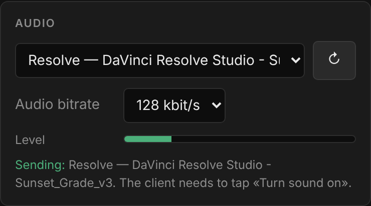

- **Дыбыссыз** — бүкіл өткізу қабілеті суретке беріледі (әдепкі).
- **Шығару құрылғысы** — Windows шығару құрылғысында ойнайтынның бәрі (мысалы, колонкаларыңызда).
- **Бір қолданба** — тек бір бағдарлама және оның еншілес процестері, мысалы тек Resolve: мессенджерлер мен браузер дыбыстары клиентке жетпейді (Windows 10 2004+).
- **Тест сигналы** — суретпен бір сағат бойынша әр секундтың басында 1 кГц бип: дыбыс клиентке жететінін және экрандағымен сәйкес келетінін тексеріңіз.
- **Дыбыс битрейті** 64 / 128 / 192 кбит/с (Opus) және деңгей индикаторы. Таңдау есте сақталады; қайта іске қосқаннан кейін қолданба атымен қайта табылады.

Клиент дыбысты дыбыс плиткасын басқаннан кейін естиді (телефондар дыбысты тек түрткеннен кейін рұқсат етеді). Интернет арқылы клиент оны баспайынша дыбыс жіберілмейді; Wi-Fi арқылы дыбыс бейнемен бірге жүреді және жай ғана қосылады.

<br clear="right">

### 7. Клиент не көреді

<p align="center">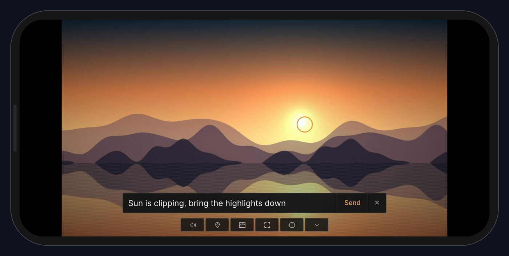</p>

Клиентте кішкентай плиткалардың бір қатары бар; қосылған плитка қызғылт сары түске боялады. Суретті түрту плиткаларды жасырады немесе қайтарады.

| Плитка | Не істейді |
|---|---|
| **Динамик** | дыбысты қосу / өшіру (сіз дыбыс таратқанда ғана көрінеді) |
| **Белгі** | белгі режимі: кадрды түртіп, плиткалардың үстіндегі жолға пікір жазып, **Жіберу** — белгі бірден сізге келеді. Кадр сәті клиент жазып болғанда емес, түрткен сәтте алынады. |
| **Скоптар** | Waveform, Parade, Vectorscope — [төменде қараңыз](#8-клиенттегі-скоптар) (сіз рұқсат берсеңіз көрінеді) |
| **Жақтау бұрыштары** | толық экран; суретті түрту плиткаларды қайтарады, сондықтан белгілер, скоптар және дыбыс толық экранда да жұмыс істейді. Толық экран қосулы тұрғанда плитка қызғылт сары — шығу үшін қайта басыңыз. **iPhone-да сілтемені Safari-де ашыңыз** — төмендегі [iPhone-дағы толық экран](#iphone-дағы-толық-экран) бөлімін қараңыз. |
| **i** | тірі статистика: ажыратымдылық, кадр/с, битрейт (және Wi-Fi арқылы кідіріс) |
| **Төмен көрсеткі** | плиткаларды жасырады |

Бет клиент телефонының тіліне бейімделеді (ағылшын, орыс немесе қазақ); скоп атаулары әрқашан ағылшынша. Интернет сілтемесі кезінде ол телефон экранының сөнуіне де жол бермейді.

#### iPhone-дағы толық экран

Apple iPhone-да веб-бетке толық экранға ашылуға рұқсат бермейді — бұл тек бейнеге болады, ал толық экрандағы бейненің үстіне ештеңе (плиткалар да, белгілер де, скоптар да) шығаруға болмайды. Плиткалары **бар** нақты толық экранның жалғыз жолы — Fullscreen API қосылған Safari:

1. iPhone-да: **Параметрлер → Қолданбалар → Safari → Қосымша → Feature Flags → Fullscreen API** — қосыңыз (бір рет). Мәзір атаулары iOS тіліне қарай сәл өзгеше болуы мүмкін.
2. GradeStream сілтемесін **Safari-де** ашыңыз. Сілтемені WhatsApp немесе Telegram-да бассаңыз, ол мессенджердің ішкі браузерінде ашылады — оның мәзірінен **Safari-де ашу** таңдаңыз.
3. Жақтау бұрыштары бар плитканы басыңыз: бет мекенжай жолағынсыз бүкіл экранды алады; суретті түрту плиткаларды шығарады.

| iPhone-дағы браузер | Толық экран плиткасы не істейді |
|---|---|
| Safari, Fullscreen API қосулы | нақты толық экран, плиткалар, белгілер және скоптар жұмыс істейді |
| Бұл баптаусыз Safari, Chrome, Firefox, Edge, мессенджерлердің ішкі браузерлері | сурет бетті алады, плиткалар жасырылады, белгілер мен скоптар жұмыс істейді, бірақ браузердің мекенжай жолағы қалады |

iPhone-дағы Chrome, Firefox және Edge Apple қозғалтқышында жұмыс істейді және Safari баптауларын көрмейді, сондықтан оларда плиткалары бар толық экран мүлде болмайды. Android, iPad және компьютерлерде ештеңе істеудің қажеті жоқ — бет кез келген заманауи браузерде толық экранға ашылады.

### 8. Клиенттегі скоптар

Клиент **Waveform, Parade және Vectorscope**-ты тікелей телефонда аша алады — төменгі қатардағы скоптар плиткасы. Олардың клиенттерде болатын-болмайтынын сіз шешесіз: **Сапа → Клиенттегі скоптар → Рұқсат етілген / Өшірулі** (өшіру оларды барлық телефондарда бірден жабады). Скоп атаулары барлық тілде ағылшынша — оларды пайдаланатындар осылай біледі.

Скоптар суретті ешқашан жаппайды. Олар ашылғанда сурет жылжиды, ал экран 10% сұр фонда қара плиткаларға бөлінеді — бос орынсыз. Екі орналасу, бір түртумен ауысады:

| Сурет ірі | Скоптар ірі |
|---|---|
| 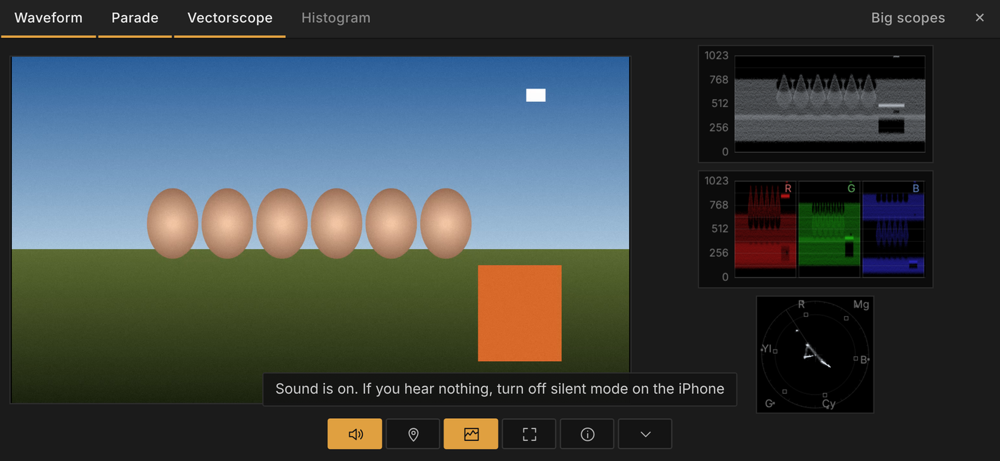 | 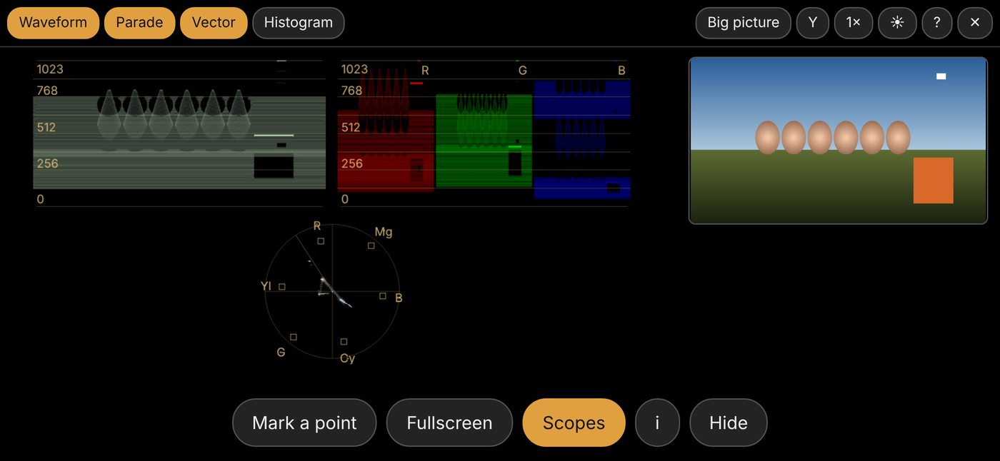 |

- **Сурет ірі** — сурет экранның шамамен үштен екісін алады, скоптар қасында (телефон тік болса, астында).
- **Скоптар ірі** — скоптар бүкіл экранда, сурет бір кішірек плиткаға айналады (телефон тік болса, жоғарыдағы жолақ). Оған бұрынғыдай белгі қоюға болады.
- Жоғарғы қойындылар әр скопты қосады және өшіреді; қалғандары үлкейіп, босаған орынды алады. Соңғы скопты өшіруге болмайды — ол үшін скоптарды айқышпен жабыңыз.
- **Colorize / Mono** — оң жақ жоғарғы бұрыштағы режим атауы бар батырма барлық скоптарды бірден ауыстырады. Colorize (әдепкі): waveform Resolve-тағы Colorize сияқты пиксельдер түсіне боялған; parade R/G/B; vectorscope сурет реңктерінде. Mono: қарада ақ із.
- Көрінісі Resolve-тағыдай: қара өріс, әр 128 сайын 0–1023 ақ шкала, сигнал үстінде жұқа тор; vectorscope-та 75% түсті жолақтар нысаналары, 100% нүктелері және тері реңкі сызығы.

<p align="center">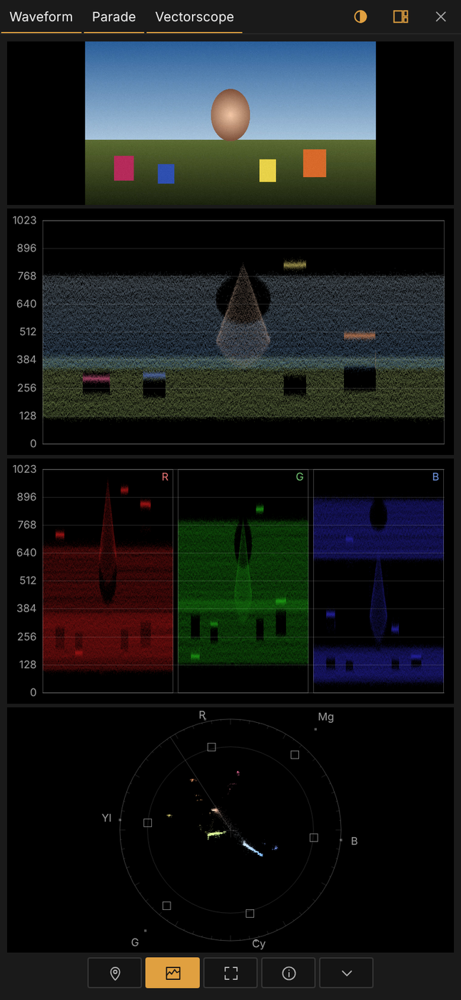</p>

**Шектен шығу индикациясы.** Скоп жақтауы қызыл болып жыпылықтап, не дұрыс емес екенін көрсетеді:

- **Waveform** — `▲ 1023` / `▼ 0`: суреттің 0,3%-ынан астамы жарықтық ауқымының ең жоғарғы немесе ең төменгі шегіне тіреледі (күйген жарықтар, қараға батқан көлеңкелер);
- **Parade** — дәл солай, R, G, B арналарының кез келгені бойынша;
- **Vectorscope** — `SAT > 100%`: суреттің 0,3%-ынан астамы сыртқы шеңберден тыс (қанықтық 100%-дан жоғары).

Тұтас қара жолдар мен бағандар (жоғарыдағы/төмендегі және бүйірлердегі кашет жолақтары) және олардың қасындағы сығудан бұлыңғыр шет есепке алынбайды, сондықтан 2,39 кең форматты кадр индикацияны қоспайды. Кадрдан кадрға жыпылықтамауы үшін индикация бір секунд тұрады.

<p align="center">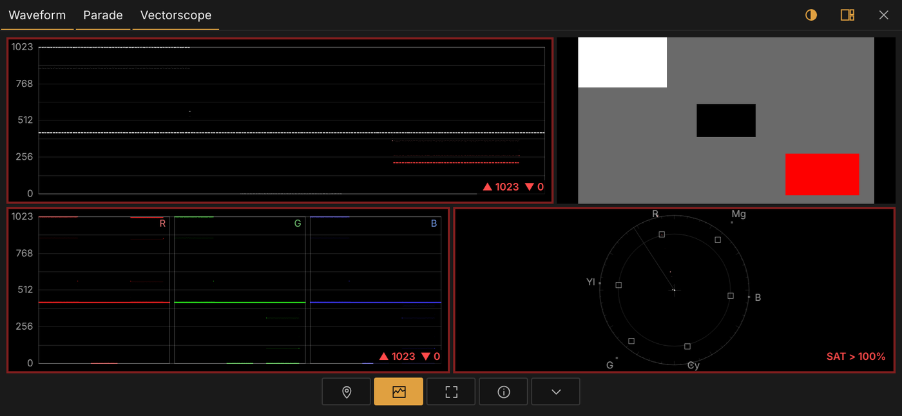</p>

**Скоптар не көрсетеді — шынын айтқанда.** Олар телефонда **келген сурет** бойынша есептеледі — 8 бит, H.264-тен кейін — 768×432 кадр көшірмесі бойынша, секундына 10 ретке дейін (баяу телефонда сирегірек). Яғни олар Resolve-тың ішкі 32 биттік суретін емес, клиент шынында алатынды көрсетеді:

- деңгейлер, баланс және қанықтық бастапқымен сәйкес: автоматты тестте (75% түсті жолақтар және сұр шкала, екі жол да) waveform-дағы жолақ деңгейлері 255-тен 1,5-тен артық айырмашылық бермейді, ал vectorscope-тағы із нысаналардан 3 px шегінде тұрады;
- кішкентай жеке жарқылдар кішірейтілген көшірмеде орташалануы мүмкін;
- із Resolve-тағы үздіксіз сигнал сияқты әр 8 биттік саты ішінде біркелкі таралады, сондықтан көлденең сызықтарға шашырамайды; іздің орны бұдан өзгермейді;
- түс туралы шешімдерді Resolve-тың өз скоптары бойынша қабылдаңыз; клиенттегі скоптар — бір суретті бір құралдармен талқылау үшін.

### 9. Клиент белгілері

<p align="center">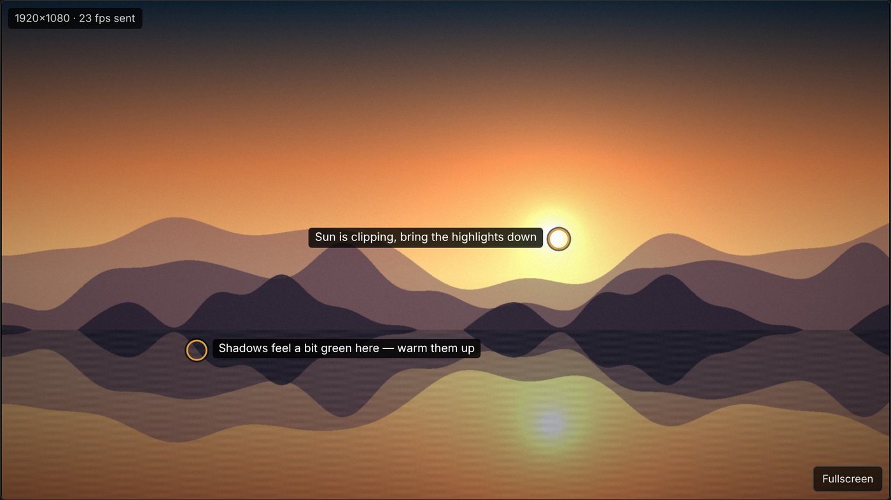</p>

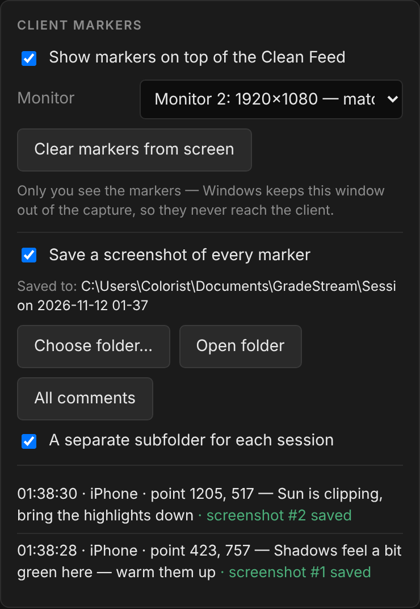

Клиент белгі қойғанда сіз аласыз:

- **дыбыстық сигнал** және алдын ала көріністе пікірі бар белгі;
- сол белгіні 20 секундқа **өз Clean Feed мониторыңыздың үстінен**. Белгілер терезесі экранды түсіруден шығарылған, сондықтан клиент оны трансляцияда көрмейді. Керек мониторды **Монитор** өрісінде таңдаңыз (ол ажыратымдылық бойынша автоматты түрде анықталады). **Белгілерді экраннан алып тастау** оларды бірден алып тастайды;
- белгілер тізімінде уақыты, құрылғысы, пиксельдегі координаттары және пікірі бар жол.

<br clear="right">

### 10. Белгі скриншоттары және пікірлер жиынтығы

Әр белгіге **клиент шынында қарап отырған кадрдың** PNG-і сақталады — бағдарлама соңғы ~4,5 секундтың кадрларын сақтап, әр көрерменнің кідірісін ескереді, — үстінде белгі, нөмір және пікір басылған:

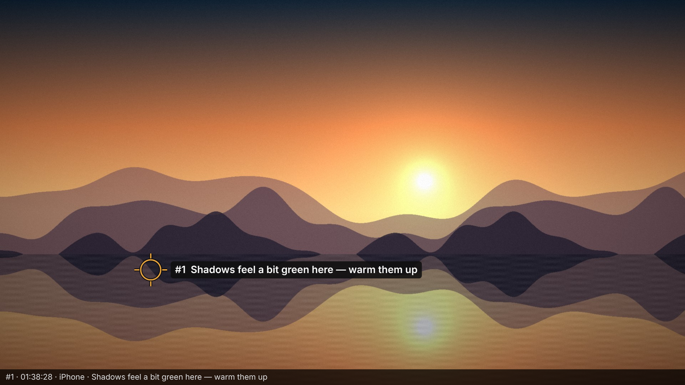

Сессияның барлық белгілері `comments.html`-ге (белгі қоюға болатын «Ескерілді» құсбелгілерімен; бет әр 10 секунд сайын өзі жаңарады — оны сессия бойы ашық ұстауға болады) және `comments.txt`-ке жиналады. Қазақ тіліндегі интерфейсте файл атаулары да қазақша болады:

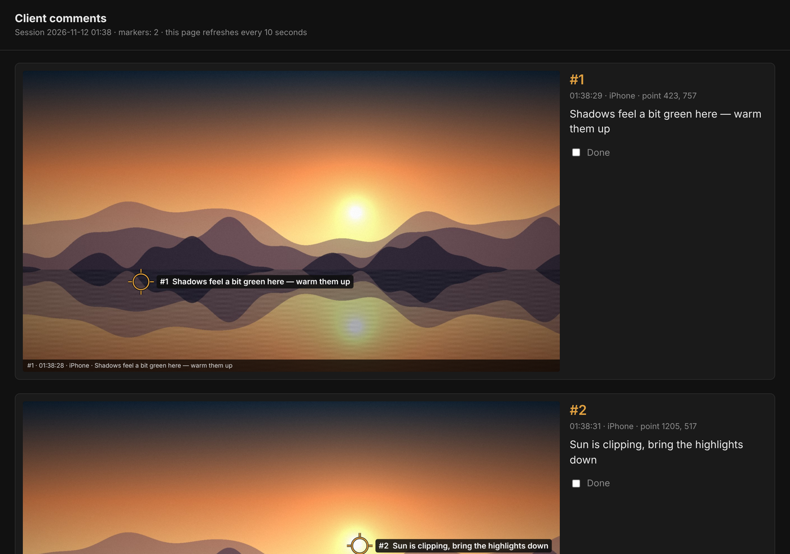

- **Қалтаны таңдау…** — қайда сақтау керек (есте сақталады; әдепкі — `Documents\GradeStream`).
- **Әр сессияға бөлек ішкі қалта** — әдепкі бойынша қосулы; өшірсеңіз, файлдар атында күні бар күйде таңдалған қалтаға тікелей жазылады. Ештеңе ешқашан қайта жазылмайды.
- **Қалтаны ашу** / **Барлық пікірлер** — қалтаны немесе жиынтық бетін ашу.

### 11. Көрермендер

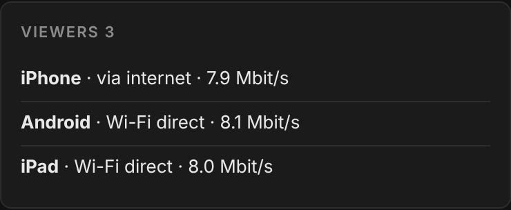

Әр көрермен құрылғы түрімен, қосылу тәсілімен (интернет арқылы / тікелей Wi-Fi), ол шынында алатын битрейтпен және дыбысты қосқан-қоспағанымен көрсетіледі. Клиенттің байланысы үлгермесе, битрейтті азайту кеңесі бар ескерту шығады.

<br clear="right">

### 12. Науадағы белгіше, тіл, жабу

- GradeStream-нің **тапсырмалар тақтасында өз белгішесі** бар (Edge/Chrome қозғалтқышында жұмыс істесе де) және **сағат жанында** белгішесі бар: басу терезені қайтарады; оң жақ батырма — **Терезені көрсету / Трансляцияны тоқтату / Шығу**. Кеңес «эфирде, көрермендер: N» деп көрсетеді.
- Трансляция кезінде терезені жиырсаңыз, бағдарлама қайда кеткені туралы бір рет хабарлама шығады.
- Трансляция кезінде терезені жабу растауды талап етеді; **Шығу** трансляцияны, туннельді және дыбыс түсіруді бірден тоқтатады.
- Жоғарғы жолдағы **EN | RU | KZ** тілді трансляцияны үзбей ауыстырады. Әдепкі бойынша бағдарлама Windows тіліне бейімделеді: қазақша Windows → қазақша, орысша → орысша, қалғаны → ағылшынша. Орнатқыш та Windows тілінде сөйлейді.

## Баптаулар анықтамалығы

Барлық баптаулар іске қосулар арасында есте сақталады.

| Баптау | Қайда | Мәндері | Әдепкі |
|---|---|---|---|
| Көрермендер қалай көреді | «Көрермендер қалай көреді» панелі | Интернет · Wi-Fi · Екеуі бірге | Интернет |
| Ажыратымдылықты келтіру | экранды таңдағаннан кейінгі диалог; алдын ала көріністің астындағы **өзгерту** | өзгеріссіз · кішірейту · үлкейту · ортадан 1:1 кесу · 16:9 (9:16) дейін кесу · жолақтармен сыйдыру | мониторыңызға ұсынылатын нұсқа |
| Битрейт | Сапа | 4 / 8 / 12 / 16 / 24 Мбит/с | 8 Мбит/с |
| Секундына кадр | Сапа | 12 / 24 / 25 / 30 / 50 / 60 | 25 |
| Көрермендерге көрсету | Сапа | Ең аз кідіріс · Біркелкі және синхронды | Ең аз кідіріс |
| Клиенттегі скоптар | Сапа | Рұқсат етілген · Өшірулі | Рұқсат етілген |
| Дыбыс көзі | Дыбыс | жоқ · шығару құрылғысы · бір қолданба · тест сигналы | жоқ |
| Дыбыс битрейті | Дыбыс | 64 / 128 / 192 кбит/с | 128 кбит/с |
| Clean Feed үстіндегі белгілер | Клиент белгілері | қосу / өшіру · монитор | қосулы · автоматты анықталады |
| Әр белгінің скриншотын сақтау | Клиент белгілері | қосу / өшіру | қосулы |
| Скриншоттар қалтасы | Клиент белгілері → Қалтаны таңдау… | кез келген қалта | `Documents\GradeStream` |
| Әр сессияға ішкі қалта | Клиент белгілері | қосу / өшіру | қосулы |
| Wi-Fi мекенжайы | Wi-Fi сілтемесі (компьютерде бірнеше желі болса көрінеді) | компьютердің жергілікті IP мекенжайлары | негізгі желі |
| Интерфейс тілі | жоғарғы жолдағы EN \| RU \| KZ | English · Русский · Қазақша | Windows тілі |

## Қалай жұмыс істейді

```
┌──────────────────── сіздің ДК (Windows) ──────────────────┐
│ Clean Feed мониторы ── экранды түсіру (Windows Graphics    │
│                        Capture, 8 биттік RGB)              │
│        ↓                                                   │
│ GradeStream терезесі (Edge/Chrome қозғалтқышы):            │
│   кесу/масштаб → 1920×1080 / 1080×1920 → H.264 (WebCodecs, │
│   бар болса аппараттық кодтаушы) ; дыбыс → Opus            │
│        ↓                                                   │
│ GradeStream.exe — трансляцияны көрермендерге таратады      │
└──────┬───────────────────────────────────────┬─────────────┘
       │ Интернет                              │ Wi-Fi
       ↓                                       ↓
 cloudflared → Cloudflare → HTTPS       жергілікті желі арқылы
 (WebSocket, TCP)                       тікелей WebRTC (UDP)
       ↓                                       ↓
 телефон: WebCodecs декодері            телефон: кіріктірілген
 → canvas                               WebRTC ойнатқышы
```

- Әр кадр **бір рет** кодталып, барлық көрермендерге екі жолмен де кетеді, сондықтан жүктеме көрермендер санымен іс жүзінде өспейді.
- Интернетте біздің серверіміз жоқ: сервер — сіздің ДК-дағы бағдарлама. Cloudflare оны тек HTTPS сілтемесі арқылы қолжетімді етеді (роутерде порт ашудың қажеті жоқ).
- Жергілікті желіде бет `http://<компьютер IP>:8790/...` мекенжайы бойынша ашылады. Браузерлер WebCodecs-ті тек HTTPS арқылы береді, сондықтан Wi-Fi арқылы бейне WebRTC арқылы жүреді: ол HTTPS-сіз жұмыс істейді және ең аз кідірісті береді.

## Техникалық сипаттамалар

### Бейне

| Параметр | Мәні |
|---|---|
| Шығыс ажыратымдылығы | 1920×1080; монитор тік бағдарда болса, 1080×1920 |
| Кадр жиілігі | 12, 24, 25, 30, 50, 60 |
| Кодек | H.264. «Интернет» режимі — High Profile; «Wi-Fi» және «Екеуі бірге» режимдері — Constrained Baseline (кез келген телефонда WebRTC арқылы кепілді ойнатылады) |
| Разрядтылық және түс субдискретизациясы | 8 бит, YCbCr 4:2:0 |
| Битрейт | 4, 8, 12, 16, 24 Мбит/с (таңдау бойынша) |
| Ағынның түс белгілері | BT.709 бастапқы түстері, BT.709 матрицасы, **толық ауқым** (0–255), **sRGB** беріліс функциясы (IEC 61966-2-1) |
| Кілттік кадрлар | кемінде 3 с сайын бір рет және көрермен қосылғанда сұрау бойынша |
| Шамадан тыс жүктеме | артық кадрлар келесі кілттік кадрға дейін тасталады (кідіріс жиналмайды) |

### Дыбыс

| Параметр | Мәні |
|---|---|
| Көзі | Windows шығару құрылғысы (WASAPI loopback) немесе еншілес процестері бар бір қолданба (process loopback, Windows 10 2004+) |
| Кодек | Opus, 48 кГц, стерео, 64/128/192 кбит/с |
| Opus декодері жоқ телефондар | сығылмаған PCM 24 кГц («Интернет» режимі) |

### Кідіріс

**Өлшенді** (тест стенді, бір компьютер, бағдарламалық кодтаушы, нақты желісіз; [толығырақ](docs/MEASUREMENTS.md)). Кадрды салудан бастап көрерменге көрсетуге дейін, әдепкі көрсету режимінде — **Ең аз кідіріс** (**Біркелкі және синхронды** үстіне өз буферін 0,12–0,7 с қосады):

| Жол | Медиана | Шашырау |
|---|---|---|
| Желінің өзінсіз интернет жолы (кодтау → сервер → WebSocket → декодтау) | 80–125 мс (бес іске қосу бойынша) | 34–185 мс |
| Wi-Fi жолы (кодтау → WebRTC → желі буфері → декодтау) | 150 мс | 122–173 мс |

**Өлшенбеген**, бірақ нақты жұмыста қосылады:

- Windows экранын түсіру — әдетте 1–2 кадр (60 Гц кезінде 17–33 мс);
- телефон экранында көрсету — 1–2 кадр;
- **Wi-Fi:** желінің өзі бірнеше миллисекунд қосады. Монитордан телефонға дейін шамамен 0,1–0,25 с күтіңіз;
- **Интернет:** сізден және клиенттен ең жақын Cloudflare деректер орталығына дейінгі жол плюс TCP. Жақсы байланыста 0,2–0,5 с күтіңіз. Нашар мобильді желіде TCP жоғалған пакеттерді қайта жібереді, сурет келесі кілттік кадрға дейін қатып қалуы мүмкін.

«Монитордан басқа қаладағы клиенттің телефонына дейін» сандары мұнда жоқ — біз оны өлшеген жоқпыз.

### Түс: неге сенуге болады, неге болмайды

**Өлшеу.** 41 патчтан тұратын кесте нақты тізбектен өтті: 0–255 сұр шкала, 100% және 75%-дағы негізгі және қосымша түстер, ColorChecker-дің 12 патчы. Екі жол үшін нәтиже ([барлық патчтар](docs/MEASUREMENTS.md)):

| | Интернет | Wi-Fi |
|---|---|---|
| Орташа ΔE2000 | 0,22 | 0,22 |
| Ең үлкен ΔE2000 | 0,75 (циан 75%) | 0,75 |
| Сұрдың бейтараптығы (ең үлкен хромдылық) | 0,01 | 0,01 |
| Қара / ақ | 0 / 255 — ауқымды сықпай | сол сияқты |

Адам байқайтын айырмашылық шегі — шамамен ΔE2000 ≈ 1,0. Қалған қате — сығу емес, RGB → 8 биттік YCbCr → RGB түрлендіру кезіндегі дөңгелектеу. Біркелкі аймақтарда H.264 осы битрейттерде іс жүзінде ештеңе жоғалтпайды, ал айқын түс белгілері бар толық ауқым декодердің деңгейлермен немесе матрицамен қателесуіне жол бермейді.

**Сенуге болады:**

- **Сигнал мәндеріне.** Resolve Clean Feed мониторына беретін RGB мәндері телефон декодеріне біркелкі аймақтарда байқалу шегінен төмен қатемен жетеді.
- **Арақатынастарға:** ақтың балансы, сұрдың бейтараптығы, тері реңктері, салыстырмалы қанықтық, «дейін/кейін» айырмашылығы.
- **Түсіруге.** Ол кадрды бейнекарта мен монитордың калибрлеу LUT-ына дейін алады. Ағын мониторыңыз оларды қалай көрсететінін емес, Resolve беретін мәндерді алып жүреді — сигналды бағалау үшін бұл дұрыс. Windows-тың түнгі жарығы мен монитордың калибрлеу қисықтары ағынға түспейді; Resolve-тың өзіндегі вьюер LUT-ы — түседі.

**Сенуге болмайды:**

1. **Телефон экранына эталон ретінде.** Бұл айырмашылықтың ең үлкен көзі — бүкіл берілістен де үлкен. Телефондар калибрленбеген; True Tone, Night Shift, автожарықтық және қуат үнемдеу ақ нүктесі мен жарықтықты өзгертеді; клиенттің көру жағдайы кез келген болуы мүмкін.
2. **Гаммаға.** Ағын sRGB деп белгіленген, телефон оны қараңғы бөлмедегі эталон монитор сияқты BT.1886 (2,4) емес, sRGB қисығымен (≈2,2) көрсетеді. Сондықтан телефонда көлеңкелер мен төменгі орта тондар ашығырақ әрі жұмсағырақ көрінеді. Көрсету осылай құрылған, бұл беріліс қатесі емес.
3. **HDR мен 10 битке.** Тек 8 биттік SDR беріледі. Егер Windows-та Clean Feed мониторы үшін HDR немесе «Қолданбалар үшін түсті автоматты басқару» қосулы болса, түсірілген мәндер қазірдің өзінде түрлендірілген — осы монитор үшін оны өшіріңіз. 10 биттік кодтау мұнда ештеңе бермес еді: Windows экран түсіруі браузерге арнаға 8 бит береді, ал телефон бетті де 8 битпен көрсетеді (өлшеумен тексерілді).
4. **Ұсақ деталь мен градиенттерге.** 4:2:0 түс ажыратымдылығын екі есе азайтады: жұқа түсті шеттер, титрлер және ұсақ қанық текстура жұмсарады. Төмен битрейтте біркелкі градиенттер (аспан, виньеткалар) баспалдақ беруі мүмкін — бұл грейд емес, 8 бит плюс сығу. Қозғалыстағы түйіршік пен шу тегістеледі. Кідіртілгенде сурет әр кілттік кадр сайын айқындала түседі.
5. **Масштабқа.** 4K монитордан клиент 1080p көреді. Деталь тексеру үшін ортадан 1:1 кесуді қолданыңыз.

**Тексерілмеген** (анық болу үшін): Windows-тың аппараттық кодтаушылары (NVENC, Quick Sync, AMF), iPhone-дағы Safari мен Android-тағы Chrome-да декодтау, нақты Windows экранын түсіру. Өлшеу Chromium-да бағдарламалық кодтаушымен синтетикалық кестеде жасалды.

**Қорытынды.** Телефонға жететін түске **сигнал ретінде** сенуге болады: біздің өлшеулер бойынша қате байқалу шегінен төмен. Телефон экранына **эталон дисплей ретінде** сенуге болмайды. Түсті соңғы бекіту үшін калибрленген монитор немесе рендерленген файл керек. GradeStream — соңғы қабылдау үшін емес, түзетулерді нақты уақытта талқылау үшін.

### Өзіңіз тексеріңіз

1. Resolve-та Clean Feed-ке белгілі мәндері бар сұр шкала мен түсті патчтарды шығарыңыз.
2. Клиенттен белгі қоюды сұраңыз. GradeStream кодтаушыға кеткеннің дәл PNG-ін сақтайды — тамызғышпен мәндердің бастапқымен сәйкес келетінін тексеріңіз. Түсіру осылай тексеріледі.
3. Телефонда экран суретін түсіріңіз. Оны түсті басқаратын бағдарламада ашыңыз (мысалы, Photoshop: «Профильге түрлендіру → sRGB») және мәндерді салыстырыңыз. Телефон декодерін қоса, бүкіл тізбек осылай тексеріледі.

## Орнату

1. [Releases](https://github.com/ushtozhish/gradestream/releases/latest) бетінен `GradeStream-Setup-<нұсқа>.zip` жүктеп, ашыңыз да, орнатқышты іске қосыңыз.
2. Windows «Windows компьютеріңізді қорғады» деп көрсетсе, «Толығырақ» → «Бәрібір іске қосу» басыңыз. Орнатқыш әзірлеуші сертификатымен қол қойылмаған.
3. Әкімші құқықтары қажет емес. Бағдарлама `%LOCALAPPDATA%\Programs\GradeStream` ішіне орнатылады және «Бастау» мәзірінде, жұмыс үстелінде және «Орнатылған қолданбалар» тізімінде пайда болады, сол жерден оны жоюға болады. Жаңа нұсқа ескісінің үстінен орнатылады.

Microsoft Edge (Windows-та бар) немесе Google Chrome керек — GradeStream түсіру мен кодтау үшін олардың қозғалтқышын пайдаланады. Нұсқа тым ескі болса, бағдарлама нені жаңарту керектігін айтады.

## Жылдам бастау

1. Resolve-та: **Workspace → Video Clean Feed →** клиентке арналған монитор.
2. GradeStream-де режимді таңдаңыз: «Интернет», «Wi-Fi» немесе «Екеуі бірге».
3. «Экранды таңдау» → «Бүкіл экран» → Clean Feed мониторын басыңыз. GradeStream терезесінің өзін басқа мониторда ұстаңыз.
4. Клиентке сілтемені жіберіңіз немесе бөлмедегілерге QR кодты көрсетіңіз.

**Wi-Fi режимі.**

- Алғаш рет Windows брандмауэрде GradeStream-ге рұқсат беруді сұрайды — «Рұқсат ету» басыңыз.
- Windows-та желі «Қоғамдық» деп белгіленсе, бағдарлама ескертеді: оны «Жеке» желіге ауыстырыңыз.
- Клиенттер оқшауланған қонақ желілері (қонақүйлер, кафелер) жарамайды.

## Қауіпсіздік және құпиялылық

- Сілтемеде кездейсоқ кілт бар, бағдарлама жабылғанда ол жұмысын тоқтатады. Әр іске қосқанда жаңа сілтеме жасалады.
- Басқару терезесі тек сіздің ДК-да ашылады.
- **«Интернет» режимі:** ағын екі бөлікте де шифрланған (HTTPS), бірақ ұштан-ұшқа шифрлау емес — Cloudflare оны әрі қарай жіберу үшін шифрын ашады. Бейне еш жерде жазылмайды және сақталмайды. Қатаң NDA бар материал үшін мұны ескеріңіз немесе «Wi-Fi» режимін қолданыңыз.
- Аккаунтсыз Cloudflare жылдам туннельдері **қолжетімділік кепілдігінсіз** жұмыс істейді. Әдетте бәрі жақсы, бірақ кейде туннель іске қосылмайды немесе үзіледі. Бағдарлама өзі қайта қосылады, бірақ сілтеме өзгереді.
- **«Wi-Fi» режимі:** ағын жергілікті желіден шықпайды. WebRTC берілісі шифрланған (DTLS-SRTP).

## Бастапқы кодтан құрастыру

[Go 1.27+](https://go.dev/dl/) және интернетке қолжетімділік керек.

```powershell
# Windows
powershell -ExecutionPolicy Bypass -File build\build.ps1
```
```bash
# Linux / macOS (Windows үшін кросс-компиляция)
./build/build.sh
```

Скрипт ресми cloudflared-ті жүктеп, Cloudflare қолтаңбасын тексереді, `app/` пен `installer/`-ді құрастырады және орнатқышты `dist/` ішіне салады.

| Қалта | Ішінде не бар |
|---|---|
| `app/` | бағдарлама: сервер, туннель, WebRTC, дыбыс түсіру (WASAPI), экран үстіндегі белгілер, науа; `web/host.html` (басқару терезесі) және `web/view.html` (көрермен) беттері; интерфейс жолдары үш тілде (EN / RU / KZ) |
| `installer/` | ағымдағы пайдаланушыға арналған орнатқыш (әкімші құқықтарынсыз), «Орнатылған қолданбаларда» тіркеу, белгішелер |
| `tests/` | өлшеулер мен тексерулер: `colortest.js` (түс, ΔE2000), `avtest.js` (дыбыс пен сурет синхрондылығы, кадр біркелкілігі), `scopetest.js` (скоптар дәлдігі), `layouttest.js` (клиенттегі орналасулар және скоптарды ауыстыру, көлденең және тік экран), `alarmtest.js` (шектен шығу индикациясы), `fullscreentest.js` (плиткалары бар толық экран, iPhone және басқалар), `i18ntest.js` (EN / RU / KZ тілдері, мәтіндердің сыйуы, скриншоттар), `run-all.sh` (бәрін іске қосады) — GitHub Actions оларды әр өзгеріс кезінде іске қосады |
| `tools/mkicon.py` | белгіше мен Windows ресурстарын жасау |

## Шектеулер

- Тек Windows 10/11 (дыбыс түсіру, экран үстіндегі белгілер және науа Windows API-ын пайдаланады).
- Бір монитор немесе бір терезе таратылады.
- Тек 8 биттік SDR; шығыс 1920×1080 немесе тік бағдардағы монитор үшін 1080×1920.
- Экран үстіндегі белгілерге Windows 10 2004+ және «Бүкіл экран» түсіру керек. Resolve Clean Feed-ті эксклюзивті толық экран режимінде көрсетсе, белгілер терезесі үстіне шыға алмайды.
- iPhone-да плиткалары бар нақты толық экран тек Fullscreen API қосылған Safari-де жұмыс істейді ([толығырақ](#iphone-дағы-толық-экран)).

## ❤️ Бауырша қолда

<a href="https://ushtozhish.github.io/support/">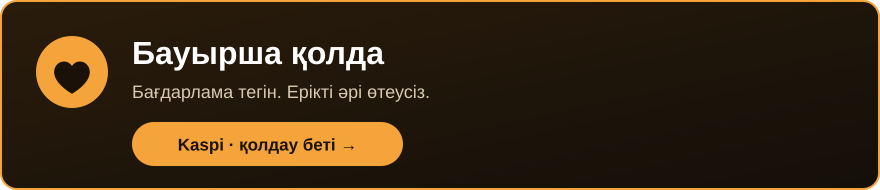</a>

> [!TIP]
> Бағдарлама тегін әрі ашық кодты. Пайдасы тисе, қалағаныңша қолда — бұл ерікті әрі өтеусіз сыйлық, оның орнына ештеңе берілмейді, бағдарлама бәріне тегін болып қала береді.
>
> - 🇰🇿 **Kaspi:** `4400 4303 6234 6964` (аударар алдында атын тексер: Артём В.)
> - 📱 **«Нөмірді көшіру» батырмасы бар бет:** https://ushtozhish.github.io/support/

## Лицензия

[MIT](LICENSE). Үшінші тарап компоненттері (cloudflared — Apache 2.0, Pion WebRTC — MIT және басқалар) [THIRD_PARTY_NOTICES.md](THIRD_PARTY_NOTICES.md) файлында көрсетілген.
