<p align="center">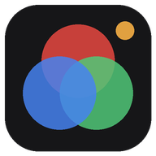</p>

<h1 align="center">GradeStream</h1>

<p align="center"><b>Stream a DaVinci Resolve Clean Feed to your client's phone via a link — nothing to install on the viewer's side.</b><br>
For colorists and editors: show a grade during a remote session or to everyone in the room, and get feedback as markers placed right on the frame.</p>

<p align="center">Windows 10/11 · free · open source (MIT) · English / Русский<br>
<a href="https://github.com/ushtozhish/gradestream/releases/latest"><b>⬇ Download the installer</b></a></p>

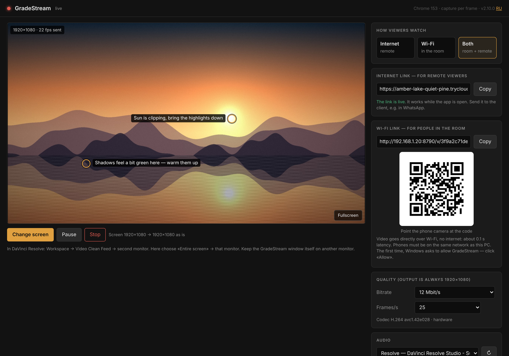

<p align="center">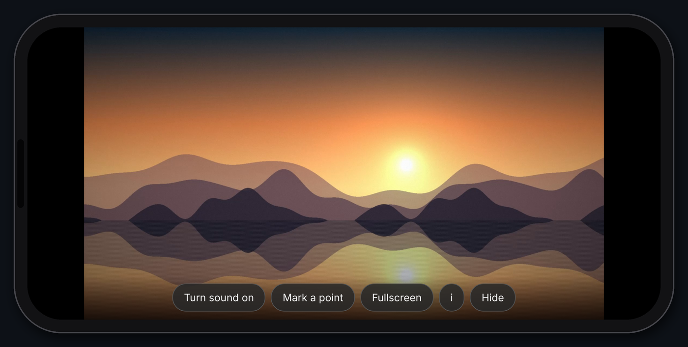<br>
<sub>What the client sees — just a link opened in Safari or Chrome.</sub></p>

> Screenshots are taken from the real interface on a test bench. Links, audio devices, monitors and the viewer list in them are sample data; the picture is an original synthetic frame.

## Contents

- [Why GradeStream](#why-gradestream)
- [Tour of the app](#tour-of-the-app)
  - [1. Control window](#1-control-window) · [2. Internet, Wi-Fi or both](#2-internet-wi-fi-or-both) · [3. Links and QR code](#3-links-and-qr-code) · [4. Always 1920×1080](#4-always-19201080) · [5. Quality](#5-quality) · [6. Audio](#6-audio) · [7. What the client sees](#7-what-the-client-sees) · [8. Client markers](#8-client-markers) · [9. Marker screenshots and the comment summary](#9-marker-screenshots-and-the-comment-summary) · [10. Viewers](#10-viewers) · [11. Tray icon, language, closing](#11-tray-icon-language-closing)
- [Settings reference](#settings-reference)
- [How it works](#how-it-works) · [Technical specification](#technical-specification) · [Color: what to trust](#color-what-to-trust-and-what-not-to)
- [Installation](#installation) · [Quick start](#quick-start) · [Security and privacy](#security-and-privacy) · [Building from source](#building-from-source) · [Limitations](#limitations)

## Why GradeStream

- **Zero friction for the client.** One link, opened on a phone during a WhatsApp/Zoom call. No app, no account, no plug-ins.
- **Built for grading reviews.** Clean Feed monitor in, a fixed 1920×1080 picture out, color-tagged so the decoder reconstructs the RGB values Resolve outputs ([measured](#color-what-to-trust-and-what-not-to): mean ΔE2000 0.22).
- **Feedback lands on the frame.** The client taps the image and types a comment; you see it on top of your Clean Feed monitor, and a screenshot of the exact frame they meant is saved with the note.
- **Remote or in the room.** Over the internet via Cloudflare Tunnel, or straight over Wi-Fi with no internet at all — or both at once.

## Tour of the app

### 1. Control window

The control window opens when you start GradeStream. The large preview shows **exactly what the client receives** — the 1920×1080 frame after cropping/scaling. Client markers appear on it too.

- **Choose screen** — pick the monitor (or a window) to stream. Choose "Entire screen" → your Clean Feed monitor.
- **Pause** — freezes the stream; the client keeps the last frame. **Stop** ends the stream.
- **Fullscreen** (or double-click the preview) — enlarges the preview.
- The top bar shows the status (live / paused / not streaming), the browser engine and capture method, the version, and the **RU/EN** language switch.

### 2. Internet, Wi-Fi or both

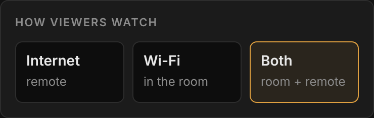

| Mode | For | How it travels | Expected latency* |
|---|---|---|---|
| **Internet** | a client in another city | Cloudflare Tunnel (HTTPS) | ≈0.2–0.5 s on a good connection |
| **Wi-Fi** | everyone in the same room | WebRTC, directly over the local network; no internet needed | ≈0.1–0.25 s |
| **Both** | a room plus remote viewers | both at once; each frame is encoded only once | as above |

<sub>* Estimates from bench measurements plus typical network delay — see [Latency](#latency).</sub>

Switching modes only disconnects people when it has to (e.g. leaving "Both" for "Wi-Fi" drops internet viewers), and the app asks first.

<br clear="right">

### 3. Links and QR code

<table><tr>
<td width="50%" valign="top">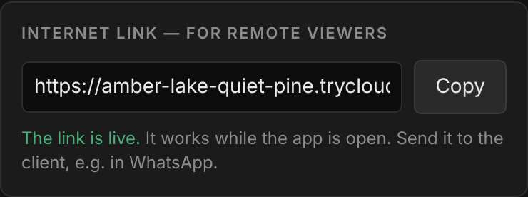<br><b>Internet link</b> — a random <code>https://…trycloudflare.com/v/…</code> address. Copy it and send it to the client. It works while the app is open and changes on every launch.</td>
<td width="50%" valign="top">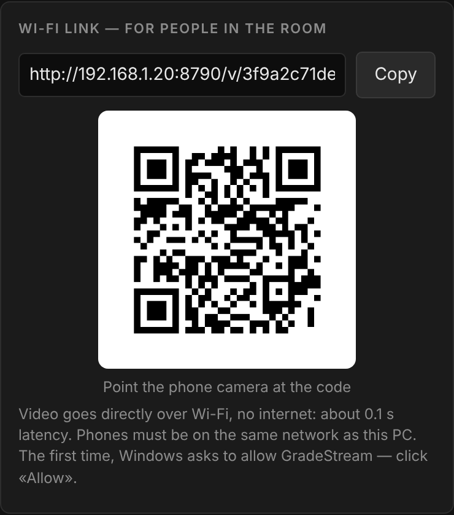<br><b>Wi-Fi link</b> — <code>http://&lt;PC IP&gt;:8790/v/…</code> with a QR code. If the PC has several network adapters, pick the address of the Wi-Fi the phones are on.</td>
</tr></table>

Click the QR code to show it full-screen — handy for a room full of people:

<p align="center">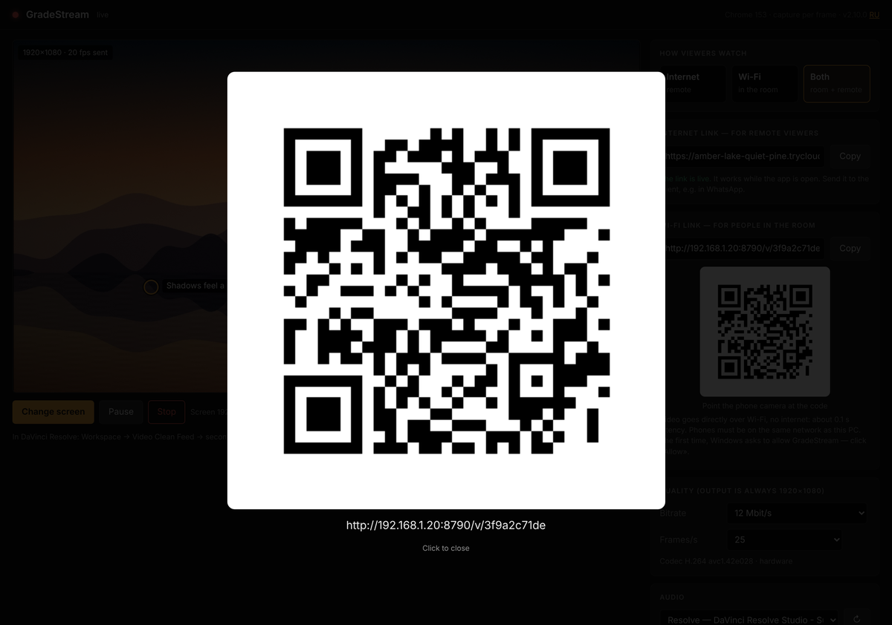</p>

### 4. Always 1920×1080

The client always gets a 1920×1080 frame. If your monitor isn't 1080p, GradeStream asks how to convert it and remembers the answer for that resolution (change it later with **change** under the preview).

<p align="center">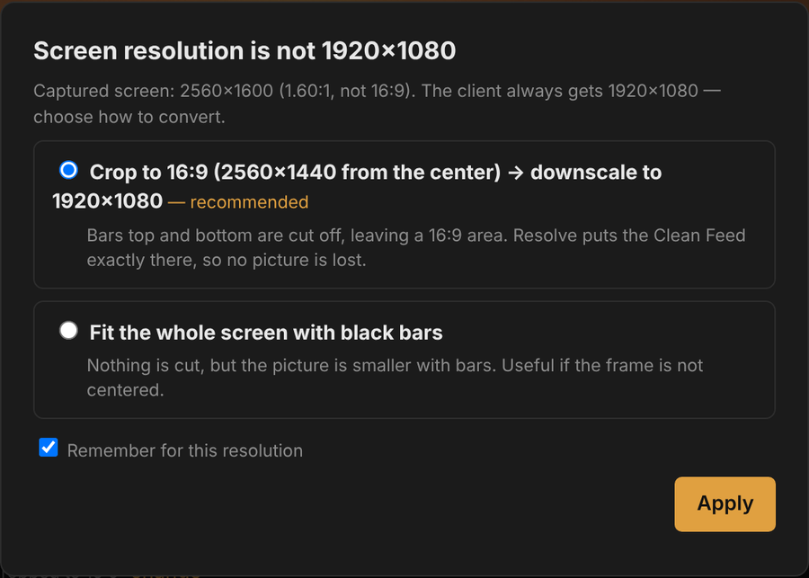</p>

| Your monitor | Options (★ recommended) |
|---|---|
| 1920×1080 | used as is |
| 4K, 1440p and other 16:9 | ★ downscale to 1920×1080 · 1:1 center crop (pixel-for-pixel, for checking grain and noise) |
| 720p and smaller 16:9 | ★ upscale to 1920×1080 |
| 1920×1200 | ★ crop the 60-px bars top and bottom (Resolve centers a 16:9 Clean Feed there) · fit with bars |
| 2560×1600, ultrawide, others | ★ crop to 16:9 from the center → scale to 1920×1080 · fit with bars |

### 5. Quality

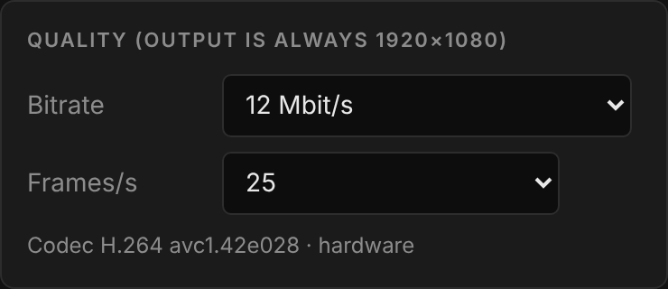

- **Bitrate** — 4 / 8 / 12 / 16 / 24 Mbit/s. 8–12 suits a phone; use 4 for a weak connection, 16–24 when gradients and fine detail matter and the network allows.
- **Frames/s** — 12 / 24 / 25 / 30 / 50 / 60. At 12 fps each frame gets about twice the bits of 25 fps: cleaner shadows and gradients while you tweak, choppier playback. Change it live.
- The line below shows the codec and whether the **hardware** encoder (NVENC / Quick Sync / AMF) is in use.

<br clear="right">

### 6. Audio

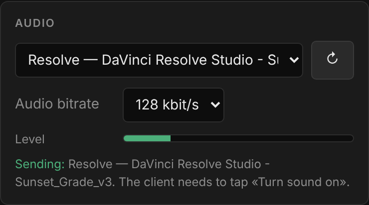

- **No audio** — all bandwidth goes to the picture (default).
- **Output device** — everything playing on a Windows output device (e.g. your speakers).
- **Single application** — only one app and its child processes, e.g. only Resolve: no messenger pings or browser sounds reach the client (Windows 10 2004+).
- **1 kHz test tone** — check that sound reaches the client before the session.
- **Audio bitrate** 64 / 128 / 192 kbit/s (Opus), plus a level meter. The choice is remembered; an app is found again by name after a restart.

The client hears sound after tapping **Turn sound on** (phones only allow audio after a tap). Over the internet, no audio data is sent to a client until they tap it; on Wi-Fi the audio travels with the video and is simply unmuted.

<br clear="right">

### 7. What the client sees

<p align="center">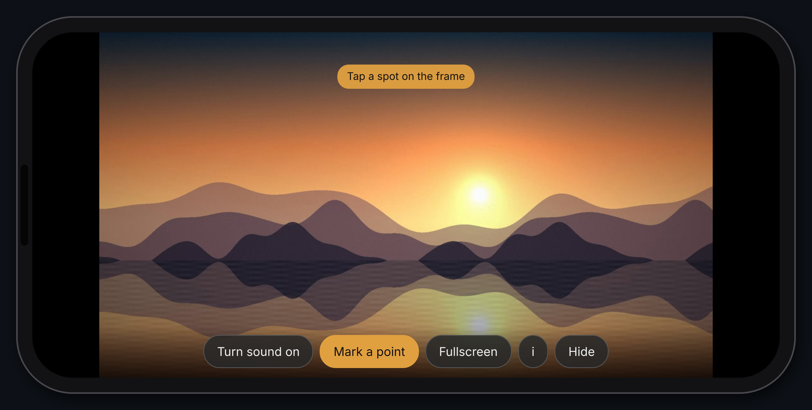</p>

| Button | What it does |
|---|---|
| **Turn sound on** | starts audio (shown only when you stream audio) |
| **Mark a point** | then tap the frame and type a comment — it reaches you instantly |
| **Fullscreen** | full-screen picture; on iPhone it uses the system video player |
| **i** | live stats: resolution, fps, bitrate (and latency on Wi-Fi) |
| **Hide** | hides the buttons; tap the screen to bring them back |

The page follows the language of the client's phone (English or Russian). With the internet link it also keeps the phone screen from dimming.

### 8. Client markers

<p align="center">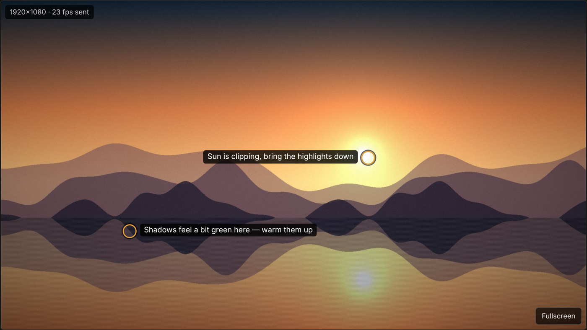</p>

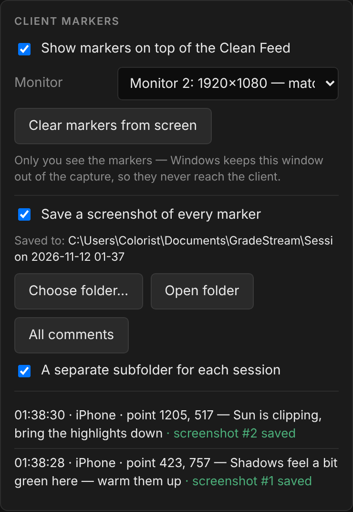

When the client places a marker you get:

- a **beep** and the marker with its comment on the preview;
- the same marker **on top of your Clean Feed monitor** for 20 s. The overlay window is excluded from screen capture, so the client never sees it in the stream. Pick the right monitor in **Monitor** (it is auto-detected by resolution). **Clear markers from screen** removes them at once;
- a line in the marker list with time, device, pixel position and comment.

<br clear="right">

### 9. Marker screenshots and the comment summary

Every marker saves a PNG of **the frame the client was actually looking at** — the app keeps the last ~4.5 s of frames and compensates for each viewer's latency — with the marker, the number and the comment burned in:

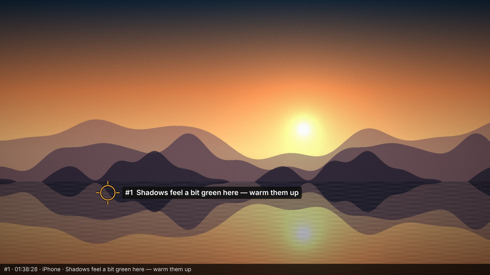

All markers of a session are collected in `comments.html` (with "Done" checkboxes, auto-refreshing every 10 s, so you can keep it open during the session) and `comments.txt`:

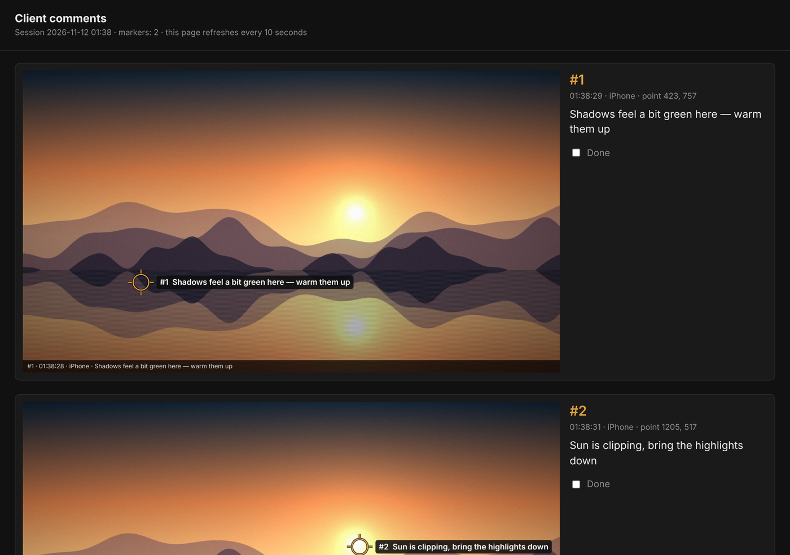

- **Choose folder…** — where to save (remembered; default `Documents\GradeStream`).
- **A separate subfolder for each session** — on by default; off writes into the chosen folder with the date in file names. Nothing is ever overwritten.
- **Open folder** / **All comments** — open the folder or the summary page.

### 10. Viewers

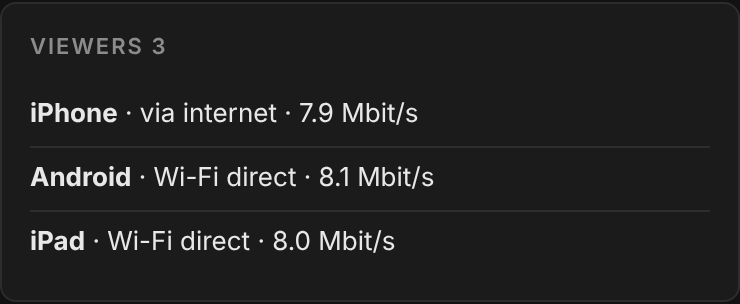

Each viewer is listed with the device type, how they're connected (via internet / Wi-Fi direct), the bitrate they actually receive, and whether they turned the sound on. If a client's connection can't keep up, a warning suggests lowering the bitrate.

<br clear="right">

### 11. Tray icon, language, closing

- GradeStream has its **own taskbar icon** (even though it uses the Edge/Chrome engine) and an icon **near the clock**: click to bring the window back; right-click for **Show window / Stop streaming / Exit**. The tooltip shows "live, viewers: N".
- Minimizing during a live stream shows a one-time notification about where the app went.
- Closing the window while live asks for confirmation; **Exit** stops the stream, the tunnel and audio capture in one go.
- **RU/EN** in the top bar switches the language without interrupting the stream. By default the app follows the Windows language.

## Settings reference

All settings are remembered between launches.

| Setting | Where | Values | Default |
|---|---|---|---|
| How viewers watch | panel "How viewers watch" | Internet · Wi-Fi · Both | Internet |
| Resolution conversion | dialog after choosing a screen; **change** under the preview | as is · downscale · upscale · 1:1 center crop · crop to 16:9 · fit with bars | recommended option for your monitor |
| Bitrate | Quality | 4 / 8 / 12 / 16 / 24 Mbit/s | 8 Mbit/s |
| Frames per second | Quality | 12 / 24 / 25 / 30 / 50 / 60 | 25 |
| Audio source | Audio | none · output device · single application · test tone | none |
| Audio bitrate | Audio | 64 / 128 / 192 kbit/s | 128 kbit/s |
| Markers on top of the Clean Feed | Client markers | on / off · monitor | on · auto-detected |
| Save a screenshot of every marker | Client markers | on / off | on |
| Screenshot folder | Client markers → Choose folder… | any folder | `Documents\GradeStream` |
| Subfolder per session | Client markers | on / off | on |
| Wi-Fi address | Wi-Fi link (shown when the PC has several networks) | the PC's local IP addresses | the main network |
| Interface language | RU/EN in the top bar | English · Русский | Windows language |

## How it works

```
┌──────────────────── your PC (Windows) ────────────────────┐
│ Clean Feed monitor ── screen capture (Windows Graphics     │
│                       Capture, 8-bit RGB)                  │
│        ↓                                                   │
│ GradeStream window (Edge/Chrome engine):                   │
│   crop/scale → 1920×1080 frame → H.264 (WebCodecs,         │
│   hardware encoder if available) ; audio → Opus            │
│        ↓                                                   │
│ GradeStream.exe — serves the stream to viewers             │
└──────┬───────────────────────────────────────┬─────────────┘
       │ Internet                              │ Wi-Fi
       ↓                                       ↓
 cloudflared → Cloudflare → HTTPS       WebRTC directly over
 (WebSocket, TCP)                       the local network (UDP)
       ↓                                       ↓
 phone: WebCodecs decoder               phone: built-in
 → canvas                               WebRTC player
```

- Each frame is encoded **once** and sent to all viewers on both paths, so the load barely grows with the number of viewers.
- There is no server of ours on the internet: the server is the app on your PC. Cloudflare only makes it reachable through an HTTPS link (no router ports to open).
- On the local network the page opens at `http://<PC IP>:8790/...`. Browsers expose WebCodecs only over HTTPS, so on Wi-Fi the video goes over WebRTC instead: it works without HTTPS and has the lowest latency.

## Technical specification

### Video

| Parameter | Value |
|---|---|
| Output resolution | always 1920×1080 |
| Frame rate | 12, 24, 25, 30, 50, 60 |
| Codec | H.264. Internet mode — High Profile; Wi-Fi and Both modes — Constrained Baseline (guaranteed to play over WebRTC on any phone) |
| Bit depth and chroma | 8-bit, YCbCr 4:2:0 |
| Bitrate | 4, 8, 12, 16, 24 Mbit/s (selectable) |
| Color tagging of the stream | BT.709 primaries, BT.709 matrix, **full range** (0–255), **sRGB** transfer (IEC 61966-2-1) |
| Keyframes | at least every 3 s and on request when a viewer joins |
| Congestion | extra frames are dropped until the next keyframe (latency does not build up) |

### Audio

| Parameter | Value |
|---|---|
| Source | a Windows output device (WASAPI loopback) or one application with its child processes (process loopback, Windows 10 2004+) |
| Codec | Opus, 48 kHz, stereo, 64/128/192 kbit/s |
| Phones without an Opus decoder | uncompressed PCM 24 kHz (internet mode) |

### Latency

**Measured** (test bench, one machine, software encoder, no real network; [details](docs/MEASUREMENTS.md)). From drawing a frame to showing it at the viewer:

| Path | Median | Range |
|---|---|---|
| Internet path without the network itself (encode → server → WebSocket → decode) | 80–125 ms (over five runs) | 34–185 ms |
| Wi-Fi path (encode → WebRTC → jitter buffer → decode) | 150 ms | 122–173 ms |

**Not measured**, but added in real use:

- Windows screen capture — usually 1–2 frames (17–33 ms at 60 Hz).
- Display on the phone screen — 1–2 frames.
- **Wi-Fi:** the network itself adds a few milliseconds. Expect roughly 0.1–0.25 s from monitor to phone.
- **Internet:** the trip to the nearest Cloudflare data center from you and from the client, plus TCP. On a good connection expect 0.2–0.5 s. On a poor mobile network TCP retransmits lost packets, and the picture may freeze until the next keyframe.

There are no "monitor to a client's phone in another city" numbers here — we have not measured that.

### Color: what to trust and what not to

**Measurement.** A 41-patch chart went through the real pipeline: gray ramp 0–255, primaries and secondaries at 100% and 75%, 12 ColorChecker patches. Result for both paths ([all patches](docs/MEASUREMENTS.md)):

| | Internet | Wi-Fi |
|---|---|---|
| Mean ΔE2000 | 0.22 | 0.22 |
| Max ΔE2000 | 0.75 (cyan 75%) | 0.75 |
| Gray neutrality (max chroma) | 0.01 | 0.01 |
| Black / white | 0 / 255 — no range compression | same |

The just-noticeable difference for a human is about ΔE2000 ≈ 1.0. The residual error is rounding in the RGB → 8-bit YCbCr → RGB conversion, not compression. On flat areas H.264 at these bitrates loses almost nothing, and full range with explicit color tagging keeps the decoder from getting levels or the matrix wrong.

**You can trust:**

- **Signal values.** The RGB values Resolve sends to the Clean Feed monitor reach the phone's decoder with an error below the visibility threshold on flat areas.
- **Relationships:** white balance, gray neutrality, skin tones, relative saturation, before/after differences.
- **The capture.** It takes the frame before the GPU/monitor calibration LUT. The stream carries the values Resolve outputs, not how your monitor displays them — which is correct for judging the signal.

**You cannot trust:**

1. **The phone screen as a reference.** This is the biggest source of mismatch — bigger than the whole transmission. Phones aren't calibrated; True Tone, Night Shift, auto-brightness and power saving change white point and brightness; the client's viewing environment can be anything.
2. **Gamma.** The stream is tagged sRGB, and the phone displays it with the sRGB curve (≈2.2), not BT.1886 (2.4) like a reference monitor in a dark room. So shadows and low midtones look lighter and softer on the phone. That's how display works, not a transmission error.
3. **HDR and 10-bit.** Only 8-bit SDR is transmitted. If HDR or "Automatically manage color for apps" is enabled in Windows for the Clean Feed monitor, the captured values are already converted — turn these off for that monitor.
4. **Fine detail and gradients.** 4:2:0 halves color resolution: thin colored edges, titles and fine saturated texture get softer. Smooth gradients (skies, vignettes) can band at low bitrates — that's 8-bit plus compression, not the grade. Grain and noise in motion get smoothed. On pause, the picture sharpens with each keyframe.
5. **Scale.** From a 4K monitor the client sees 1080p. Use the 1:1 center-crop option to check detail.

**Not tested** (to be clear): Windows hardware encoders (NVENC, Quick Sync, AMF), decoding in Safari on iPhone and Chrome on Android, capture of a real Windows screen. The measurement was done in Chromium with a software encoder on a synthetic chart.

**Bottom line.** The color that reaches the phone can be trusted **as a signal**: in our measurements the error is below the visibility threshold. The phone screen cannot be trusted **as a reference display**. For final color approval you need a calibrated monitor or a rendered file. GradeStream is for discussing changes in real time, not for final sign-off.

### Check it yourself

1. Put a gray ramp and color patches with known values on the Clean Feed output in Resolve.
2. Ask the client to place a marker. GradeStream saves a PNG of exactly what went into the encoder — check with a color picker that the values match the source. This verifies the capture.
3. Take a screenshot on the phone. Open it in a color-managed app (e.g. Photoshop: "Convert to Profile → sRGB") and compare values. This verifies the whole chain, including the phone's decoder.

## Installation

1. Download `GradeStream-Setup-<version>.zip` from [Releases](https://github.com/ushtozhish/gradestream/releases/latest), unzip it and run the installer.
2. If Windows shows "Windows protected your PC", click "More info" → "Run anyway". The installer isn't signed with a developer certificate.
3. No admin rights needed. The app installs to `%LOCALAPPDATA%\Programs\GradeStream` and appears in the Start menu, on the desktop and in "Installed apps", where you can uninstall it.

Requires Microsoft Edge (preinstalled on Windows) or Google Chrome — GradeStream uses their engine for capture and encoding. If the version is too old, the app tells you what to update.

## Quick start

1. In Resolve: **Workspace → Video Clean Feed →** the monitor for the client.
2. In GradeStream, choose a mode: "Internet", "Wi-Fi" or "Both".
3. Click "Choose screen" → "Entire screen" → the Clean Feed monitor. Keep the GradeStream window itself on another monitor.
4. Send the client the link, or show the QR code to people in the room.

**Wi-Fi mode.**

- The first time, Windows asks to allow GradeStream through the firewall — click "Allow".
- If the network is marked "Public" in Windows, the app warns you: switch it to "Private".
- Guest networks with client isolation (hotels, cafés) won't work.

## Security and privacy

- The link contains a random key and stops working when the app is closed. A new link is generated on every launch.
- The control window opens only on your PC.
- **Internet mode:** the stream is encrypted (HTTPS) on both legs, but not end-to-end — Cloudflare decrypts it to forward it. Video is never recorded or stored. For material under a strict NDA, keep this in mind or use Wi-Fi mode.
- Cloudflare's account-less quick tunnels come **with no uptime guarantee**. They usually work fine but occasionally fail to start or drop. The app reconnects on its own, but the link changes.
- **Wi-Fi mode:** the stream never leaves the local network. WebRTC transport is encrypted (DTLS-SRTP).

## Building from source

Requires [Go 1.27+](https://go.dev/dl/) and internet access.

```powershell
# Windows
powershell -ExecutionPolicy Bypass -File build\build.ps1
```
```bash
# Linux / macOS (cross-compiling for Windows)
./build/build.sh
```

The script downloads the official cloudflared, verifies Cloudflare's signature, builds `app/` and `installer/`, and puts the installer in `dist/`.

| Folder | Contents |
|---|---|
| `app/` | the app: server, tunnel, WebRTC, audio capture (WASAPI), on-screen markers, tray; pages `web/host.html` (control window) and `web/view.html` (viewer) |
| `installer/` | per-user installer (no admin rights), "Installed apps" registration, shortcuts |
| `tests/colortest.js` | color and latency measurement — [how to run](docs/MEASUREMENTS.md) |
| `tools/mkicon.py` | icon and Windows resource generation |

## Limitations

- Windows 10/11 only (audio capture, on-screen markers and the tray use Windows APIs).
- One monitor or one window is streamed.
- 8-bit SDR, 1080p output only.
- On-screen markers require Windows 10 2004+ and "Entire screen" capture. If Resolve shows the Clean Feed in exclusive fullscreen, the marker overlay can't appear on top of it.

## License

[MIT](LICENSE). Third-party components (cloudflared — Apache 2.0, Pion WebRTC — MIT, and others) are listed in [THIRD_PARTY_NOTICES.md](THIRD_PARTY_NOTICES.md).
