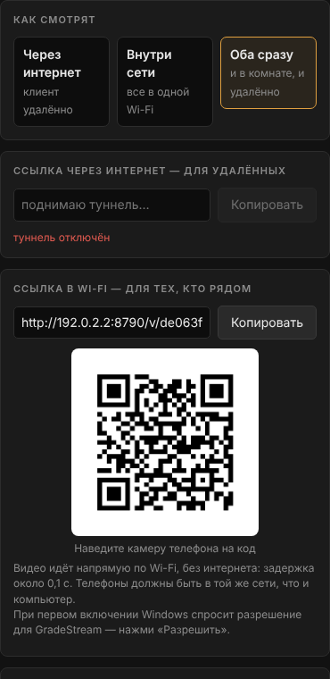

# GradeStream

**Stream a DaVinci Resolve Clean Feed to your client's phone via a link — nothing to install on the viewer's side.**
A tool for colorists and editors: show a grade during a remote session or to everyone in the room, and get feedback as markers placed directly on the frame.

Windows 10/11 · free · MIT · [download the installer](https://github.com/ushtozhish/gradestream/releases/latest)



> The app interface is currently in Russian.

## Features

- **A link for the client.** The client opens it on a phone — for example, during a WhatsApp call — and sees your Clean Feed monitor. No app, no sign-up: Safari on iPhone, Chrome on Android.
- **Three modes**:
  - **Internet** — remote client, link via Cloudflare Tunnel;
  - **Wi-Fi** — everyone in the same room; video goes directly over the local network, no internet needed, link and QR code shown on screen;
  - **Both** — both links at once.
- **Always 1920×1080 out.** If the monitor isn't 1080p, the app offers a downscale (4K, 1440p), a 1:1 center crop for checking grain, a crop of the extra margins (1920×1200, ultrawide) or a fit with letterboxing. The choice is remembered per resolution.
- **Client markers.** The client taps «Отметить точку» (Mark a point), taps the frame and types a comment. On your side:
  - the marker appears on top of your Clean Feed monitor (it is not part of the stream);
  - a PNG of the exact frame the client was looking at (latency-compensated) is saved with the marker and the comment;
  - a `комментарии.html` summary with «Учтено» (Done) checkboxes and a `комментарии.txt` list are kept. You choose the folder.
- **Audio, optional:** no audio (all bandwidth goes to the picture), a whole Windows output device, or a single application (e.g. only Resolve).
- **Quality:** 4–24 Mbit/s, 12/24/25/30/50/60 fps, pause (the client keeps the last frame).
- **Conveniences:** fullscreen for the client and for your preview, a tray icon (show window, stop, exit), its own taskbar icon.

## How it works

```
┌──────────────────── your PC (Windows) ────────────────────┐
│ Clean Feed monitor ── screen capture (Windows Graphics     │
│                       Capture, 8-bit RGB)                  │
│        ↓                                                   │
│ GradeStream window (Edge/Chrome engine):                   │
│   crop/scale → 1920×1080 frame → H.264 (WebCodecs,         │
│   hardware encoder if available) ; audio → Opus            │
│        ↓                                                   │
│ GradeStream.exe — serves the stream to viewers             │
└──────┬───────────────────────────────────────┬─────────────┘
       │ Internet                              │ Wi-Fi
       ↓                                       ↓
 cloudflared → Cloudflare → HTTPS       WebRTC directly over
 (WebSocket, TCP)                       the local network (UDP)
       ↓                                       ↓
 phone: WebCodecs decoder               phone: built-in
 → canvas                               WebRTC player
```

- Each frame is encoded **once** and sent to all viewers on both paths, so the load barely grows with the number of viewers.
- There is no server of ours on the internet: the server is the app on your PC. Cloudflare only makes it reachable through an HTTPS link (no router ports to open).
- On the local network the page opens at `http://<PC IP>:8790/...`. Browsers expose WebCodecs only over HTTPS, so on Wi-Fi the video goes over WebRTC instead: it works without HTTPS and has the lowest latency.

## Technical specification

### Video

| Parameter | Value |
|---|---|
| Output resolution | always 1920×1080 |
| Frame rate | 12, 24, 25, 30, 50, 60 |
| Codec | H.264. Internet mode — High Profile; Wi-Fi and Both modes — Constrained Baseline (guaranteed to play over WebRTC on any phone) |
| Bit depth and chroma | 8-bit, YCbCr 4:2:0 |
| Bitrate | 4, 8, 12, 16, 24 Mbit/s (selectable) |
| Color tagging of the stream | BT.709 primaries, BT.709 matrix, **full range** (0–255), **sRGB** transfer (IEC 61966-2-1) |
| Keyframes | at least every 3 s and on request when a viewer joins |
| Congestion | extra frames are dropped until the next keyframe (latency does not build up) |

### Audio

| Parameter | Value |
|---|---|
| Source | a Windows output device (WASAPI loopback) or one application with its child processes (process loopback, Windows 10 2004+) |
| Codec | Opus, 48 kHz, stereo, 64/128/192 kbit/s |
| Phones without an Opus decoder | uncompressed PCM 24 kHz (internet mode) |

### Latency

**Measured** (test bench, one machine, software encoder, no real network; [details](docs/MEASUREMENTS.md)). From drawing a frame to showing it at the viewer:

| Path | Median | Range |
|---|---|---|
| Internet path without the network itself (encode → server → WebSocket → decode) | 80–125 ms (over five runs) | 34–185 ms |
| Wi-Fi path (encode → WebRTC → jitter buffer → decode) | 150 ms | 122–173 ms |

**Not measured**, but added in real use:

- Windows screen capture — usually 1–2 frames (17–33 ms at 60 Hz).
- Display on the phone screen — 1–2 frames.
- **Wi-Fi:** the network itself adds a few milliseconds. Expect roughly 0.1–0.25 s from monitor to phone.
- **Internet:** the trip to the nearest Cloudflare data center from you and from the client, plus TCP. On a good connection expect 0.2–0.5 s. On a poor mobile network TCP retransmits lost packets, and the picture may freeze until the next keyframe.

There are no "monitor to a client's phone in another city" numbers here — we have not measured that.

### Color: what to trust and what not to

**Measurement.** A 41-patch chart went through the real pipeline: gray ramp 0–255, primaries and secondaries at 100% and 75%, 12 ColorChecker patches. Result for both paths ([all patches](docs/MEASUREMENTS.md)):

| | Internet | Wi-Fi |
|---|---|---|
| Mean ΔE2000 | 0.22 | 0.22 |
| Max ΔE2000 | 0.75 (cyan 75%) | 0.75 |
| Gray neutrality (max chroma) | 0.01 | 0.01 |
| Black / white | 0 / 255 — no range compression | same |

The just-noticeable difference for a human is about ΔE2000 ≈ 1.0. The residual error is rounding in the RGB → 8-bit YCbCr → RGB conversion, not compression. On flat areas H.264 at these bitrates loses almost nothing, and full range with explicit color tagging keeps the decoder from getting levels or the matrix wrong.

**You can trust:**

- **Signal values.** The RGB values Resolve sends to the Clean Feed monitor reach the phone's decoder with an error below the visibility threshold on flat areas.
- **Relationships:** white balance, gray neutrality, skin tones, relative saturation, before/after differences.
- **The capture.** It takes the frame before the GPU/monitor calibration LUT. The stream carries the values Resolve outputs, not how your monitor displays them — which is correct for judging the signal.

**You cannot trust:**

1. **The phone screen as a reference.** This is the biggest source of mismatch — bigger than the whole transmission. Phones aren't calibrated; True Tone, Night Shift, auto-brightness and power saving change white point and brightness; the client's viewing environment can be anything.
2. **Gamma.** The stream is tagged sRGB, and the phone displays it with the sRGB curve (≈2.2), not BT.1886 (2.4) like a reference monitor in a dark room. So shadows and low midtones look lighter and softer on the phone. That's how display works, not a transmission error.
3. **HDR and 10-bit.** Only 8-bit SDR is transmitted. If HDR or "Automatically manage color for apps" is enabled in Windows for the Clean Feed monitor, the captured values are already converted — turn these off for that monitor.
4. **Fine detail and gradients.** 4:2:0 halves color resolution: thin colored edges, titles and fine saturated texture get softer. Smooth gradients (skies, vignettes) can band at low bitrates — that's 8-bit plus compression, not the grade. Grain and noise in motion get smoothed. On pause, the picture sharpens with each keyframe.
5. **Scale.** From a 4K monitor the client sees 1080p. Use the 1:1 center-crop option to check detail.

**Not tested** (to be clear): Windows hardware encoders (NVENC, Quick Sync, AMF), decoding in Safari on iPhone and Chrome on Android, capture of a real Windows screen. The measurement was done in Chromium with a software encoder on a synthetic chart.

**Bottom line.** The color that reaches the phone can be trusted **as a signal**: in our measurements the error is below the visibility threshold. The phone screen cannot be trusted **as a reference display**. For final color approval you need a calibrated monitor or a rendered file. GradeStream is for discussing changes in real time, not for final sign-off.

### Check it yourself

1. Put a gray ramp and color patches with known values on the Clean Feed output in Resolve.
2. Ask the client to place a marker. GradeStream saves a PNG of exactly what went into the encoder — check with a color picker that the values match the source. This verifies the capture.
3. Take a screenshot on the phone. Open it in a color-managed app (e.g. Photoshop: "Convert to Profile → sRGB") and compare values. This verifies the whole chain, including the phone's decoder.

## Installation

1. Download `GradeStream-Setup-<version>.zip` from [Releases](https://github.com/ushtozhish/gradestream/releases/latest), unzip it and run the installer.
2. If Windows shows "Windows protected your PC", click "More info" → "Run anyway". The installer isn't signed with a developer certificate.
3. No admin rights needed. The app installs to `%LOCALAPPDATA%\Programs\GradeStream` and appears in the Start menu, on the desktop and in "Installed apps", where you can uninstall it.

Requires Microsoft Edge (preinstalled on Windows) or Google Chrome — GradeStream uses their engine for capture and encoding. If the version is too old, the app tells you what to update.

## Usage

1. In Resolve: **Workspace → Video Clean Feed →** the monitor for the client.
2. In GradeStream, choose a mode: «Интернет» (Internet), «Wi-Fi» or «Оба сразу» (Both).
3. Click «Выбрать экран» (Choose screen) → "Entire screen" → the Clean Feed monitor. Keep the GradeStream window itself on another monitor.
4. Send the client the link, or show the QR code to people in the room.

**Wi-Fi mode.**

- The first time, Windows asks to allow GradeStream through the firewall — click "Allow".
- If the network is marked "Public" in Windows, the app warns you: switch it to "Private".
- Guest networks with client isolation (hotels, cafés) won't work.

## Security and privacy

- The link contains a random key and stops working when the app is closed. A new link is generated on every launch.
- The control window opens only on your PC.
- **Internet mode:** the stream is encrypted (HTTPS) on both legs, but not end-to-end — Cloudflare decrypts it to forward it. Video is never recorded or stored. For material under a strict NDA, keep this in mind or use Wi-Fi mode.
- Cloudflare's account-less quick tunnels come **with no uptime guarantee**. They usually work fine but occasionally fail to start or drop. The app reconnects on its own, but the link changes.
- **Wi-Fi mode:** the stream never leaves the local network. WebRTC transport is encrypted (DTLS-SRTP).

## Building from source

Requires [Go 1.27+](https://go.dev/dl/) and internet access.

```powershell
# Windows
powershell -ExecutionPolicy Bypass -File build\build.ps1
```
```bash
# Linux / macOS (cross-compiling for Windows)
./build/build.sh
```

The script downloads the official cloudflared, verifies Cloudflare's signature, builds `app/` and `installer/`, and puts the installer in `dist/`.

| Folder | Contents |
|---|---|
| `app/` | the app: server, tunnel, WebRTC, audio capture (WASAPI), on-screen markers, tray; pages `web/host.html` (control window) and `web/view.html` (viewer) |
| `installer/` | per-user installer (no admin rights), "Installed apps" registration, shortcuts |
| `tests/colortest.js` | color and latency measurement — [how to run](docs/MEASUREMENTS.md) |
| `tools/mkicon.py` | icon and Windows resource generation |

## Limitations

- Windows 10/11 only (audio capture, on-screen markers and the tray use Windows APIs).
- One monitor or one window is streamed.
- 8-bit SDR, 1080p output only.
- On-screen markers require Windows 10 2004+ and "Entire screen" capture. If Resolve shows the Clean Feed in exclusive fullscreen, the marker overlay can't appear on top of it.
- The interface is in Russian.

## License

[MIT](LICENSE). Third-party components (cloudflared — Apache 2.0, Pion WebRTC — MIT, and others) are listed in [THIRD_PARTY_NOTICES.md](THIRD_PARTY_NOTICES.md).
