<p align="right"><a href="README.md">English</a> · <b>Русский</b></p>

<p align="center">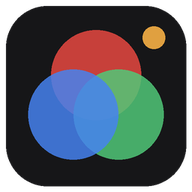</p>

<h1 align="center">GradeStream</h1>

<p align="center"><b>Трансляция Clean Feed из DaVinci Resolve на телефон клиента по ссылке. Зрителю ничего не нужно устанавливать.</b><br>
Для колористов и монтажёров: покажите грейд во время удалённой сессии или всем, кто в комнате, и получите замечания метками прямо на кадре.</p>

<p align="center">Windows 10/11 · бесплатно · открытый код (MIT) · English / Русский<br>
<a href="https://github.com/ushtozhish/gradestream/actions/workflows/build-and-measure.yml"></a><br>
<a href="https://github.com/ushtozhish/gradestream/releases/latest"><b>⬇ Скачать установщик</b></a></p>

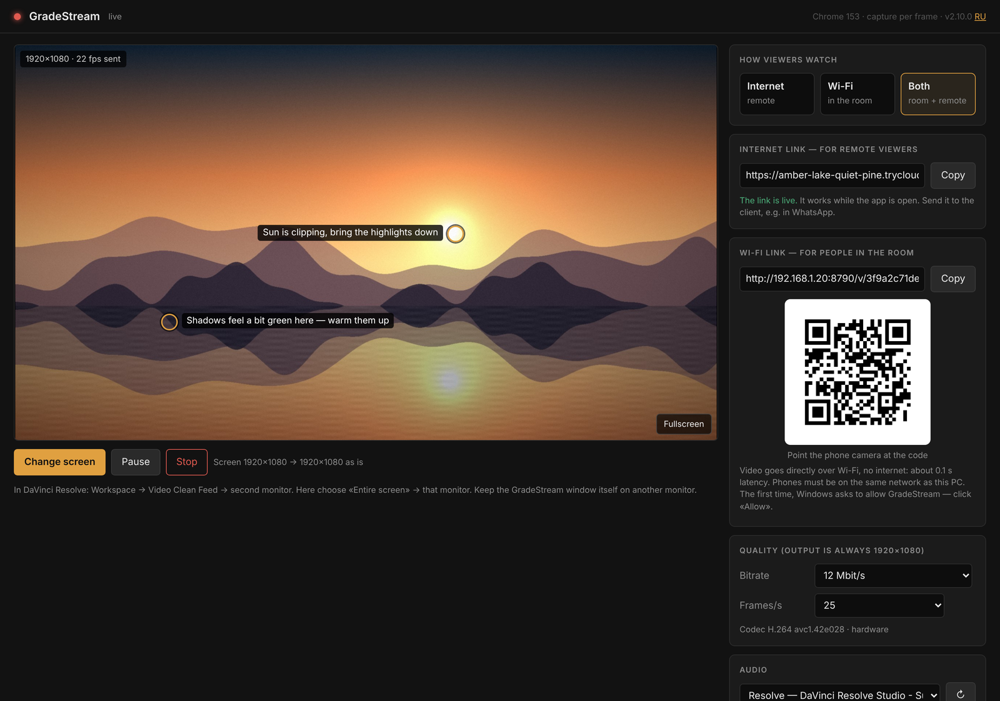

<p align="center">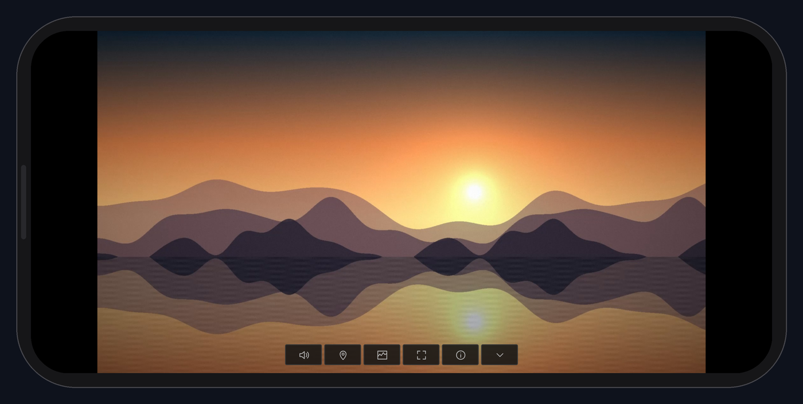<br>
<sub>Что видит клиент — просто ссылка, открытая в Safari или Chrome.</sub></p>

> Скриншоты сняты с настоящего интерфейса на тестовом стенде. Ссылки, звуковые устройства, мониторы и список зрителей на них — примерные; картинка — оригинальный синтетический кадр. Окно управления на скриншотах — на английском, в программе можно переключить на русский.

## Содержание

- [Зачем GradeStream](#зачем-gradestream)
- [Удалённый просмотр монтажа: звук синхронно, плавная картинка](#удалённый-просмотр-монтажа-звук-синхронно-плавная-картинка)
- [Обзор программы](#обзор-программы)
  - [1. Окно управления](#1-окно-управления) · [2. Интернет, Wi-Fi или оба](#2-интернет-wi-fi-или-оба) · [3. Ссылки и QR-код](#3-ссылки-и-qr-код) · [4. 1920×1080 или 1080×1920 для вертикальных видео](#4-19201080-или-10801920-для-вертикальных-видео) · [5. Качество](#5-качество) · [6. Звук](#6-звук) · [7. Что видит клиент](#7-что-видит-клиент) ([полный экран на iPhone](#полный-экран-на-iphone)) · [8. Скопы у клиента](#8-скопы-у-клиента) · [9. Метки клиента](#9-метки-клиента) · [10. Снимки меток и сводка комментариев](#10-снимки-меток-и-сводка-комментариев) · [11. Зрители](#11-зрители) · [12. Значок в трее, язык, закрытие](#12-значок-в-трее-язык-закрытие)
- [Справочник настроек](#справочник-настроек)
- [Как это устроено](#как-это-устроено) · [Технические характеристики](#технические-характеристики) · [Цвет: чему верить, а чему нет](#цвет-чему-верить-а-чему-нет)
- [Установка](#установка) · [Быстрый старт](#быстрый-старт) · [Безопасность и конфиденциальность](#безопасность-и-конфиденциальность) · [Сборка из исходников](#сборка-из-исходников) · [Ограничения](#ограничения)

## Зачем GradeStream

- **Клиенту ничего не нужно.** Одна ссылка, открытая на телефоне во время звонка в WhatsApp или Zoom. Без приложений, аккаунтов и плагинов.
- **Сделано для сдачи грейда.** На входе — монитор с Clean Feed, на выходе — картинка 1920×1080 (1080×1920 для вертикальных видео) с цветовой разметкой, по которой декодер восстанавливает те же значения RGB, что выдаёт Resolve ([замерено](#цвет-чему-верить-а-чему-нет): средний ΔE2000 0,22).
- **Замечания — прямо на кадре.** Клиент касается картинки и пишет комментарий; вы видите метку поверх своего монитора с Clean Feed, а снимок именно того кадра, о котором речь, сохраняется вместе с комментарием.
- **Удалённо или в одной комнате.** Через интернет (Cloudflare Tunnel), напрямую по Wi-Fi вообще без интернета — или оба способа сразу.
- **И для просмотра монтажа.** Режим подачи «Плавно и синхронно» держит звук синхронно с картинкой, а кадры — ровно, поэтому удалённый режиссёр может оценивать склейки и ритм ([замерено](#удалённый-просмотр-монтажа-звук-синхронно-плавная-картинка)).

## Удалённый просмотр монтажа: звук синхронно, плавная картинка

Режиссёр или продюсер может смотреть монтаж удалённо со звуком: открыть ссылку, нажать плитку звука, а в GradeStream выбрать **Подача → Плавно и синхронно**.

**Как это работает.** Каждый кадр и каждые 20 мс звука помечаются моментом захвата по одним часам (звук — по отметкам времени звукового движка Windows, где он их даёт; видео — по моменту захвата). Телефон зрителя оценивает, с каким опозданием и разбросом приходят данные, и показывает всё в момент *захват + одинаковая задержка*:

- **одинаковая задержка** для звука и картинки → они совпадают;
- **буфер под разброс сети** (0,12–0,7 с, подстраивается сам) → кадры идут ровно, и сеть не искажает ритм склеек;
- по Wi-Fi то же самое делает встроенная синхронизация WebRTC в браузере — по отчётам отправителя с часами захвата.

**Замерено** (тестовый стенд: окно управления вспыхивает белым в начале каждой секунды, в тот же момент звучит бип тестового сигнала; телефон зрителя записывает, когда показана вспышка и когда бип дошёл до звукового выхода; неровная сеть имитируется задержкой каждого сообщения на 0–120 мс):

| | Звук относительно картинки (минус = звук раньше) | Ровность кадров при 25 к/с* |
|---|---|---|
| Интернет, «Плавно и синхронно», без разброса | медиана −13…+17 мс, события −64…+29 мс | отклонение, медиана 9 мс |
| Интернет, «Плавно и синхронно», разброс 0–120 мс | медиана −12…−16 мс, события −66…+1 мс | отклонение, медиана 8–10 мс, **19%** интервалов длиннее 60 мс |
| Интернет, «Минимальная задержка», разброс 0–120 мс | — (без звука) | отклонение, медиана 25–27 мс, **33–36%** интервалов длиннее 60 мс |
| Wi-Fi (WebRTC), «Плавно и синхронно» | −4…−11 мс (оценка браузера**) | как у источника |
| Wi-Fi (WebRTC), «Минимальная задержка» | +17…+27 мс (оценка браузера**) | как у источника |

<sub>* Отклонение интервалов показа от 40 мс. На этом стенде даже без разброса 14–15% интервалов длиннее 60 мс — из-за синтетического источника и экрана 60 Гц, так что 19% при разбросе близко к этому пределу, а «Минимальная задержка» его удваивает. ** `estimatedPlayoutTimestamp` из статистики WebRTC, а не замер по вспышке и бипу.</sub>

Для сравнения: по ITU-R BT.1359 порог *заметности* — около 45 мс опережения звука и 125 мс отставания. Все медианы выше укладываются в него. Замеры автоматически выполняются на GitHub при каждом изменении — последние результаты в [Actions → Build and measure](https://github.com/ushtozhish/gradestream/actions/workflows/build-and-measure.yml) (сводка запуска).

**Для чего подходит:** оценка монтажа, ритма, игры актёров, синхрона, музыкальных склеек, черновой и чистовой сборки; несколько человек смотрят одновременно и ставят метки на кадрах.

**Чем не является:**

- **Не покадрово точное воспроизведение.** GradeStream захватывает экран. Если частота монитора не кратна частоте таймлайна (например, таймлайн 23,976/24p на мониторе 60 Гц), неровность (pulldown 3:2) есть уже на самом мониторе, и поток её наследует. Для самого ровного движения поставьте монитору с Clean Feed частоту, кратную таймлайну (48/72/120 Гц для 24p, 50/100 Гц для 25p), а в GradeStream — частоту кадров таймлайна.
- **Не для оценки финального сведения.** Opus на 128–192 кбит/с звучит чисто, но динамик телефона и наушники — не студия сведения.
- **Не совместная работа в реальном времени.** Зрители смотрят и комментируют; монтаж идёт на вашем компьютере.
- **Буфер синхронизации добавляет задержку.** В режиме «Плавно и синхронно» зрители видят картинку на 0,12–0,7 с позже, чем в «Минимальной задержке». Для живой цветокоррекции оставляйте «Минимальную задержку».
- **На реальной сети не замерялось.** Выше — имитация разброса 0–120 мс. На плохой мобильной связи из-за потерь TCP подвисает; паузы длиннее буфера всё равно видны как замирания.

В версиях до 2.11 звук и картинка шли независимо, без синхронизации, и звук отставал от картинки.

## Обзор программы

### 1. Окно управления

Окно управления открывается при запуске GradeStream. Большой предпросмотр показывает **ровно то, что получает клиент** — кадр 1920×1080 (или 1080×1920) после обрезки и масштаба. На нём же появляются метки клиента.

- **Выбрать экран** — какой монитор (или окно) транслировать. Выберите «Весь экран» → монитор с Clean Feed.
- **Пауза** — замораживает трансляцию, у клиента остаётся последний кадр. **Стоп** завершает трансляцию.
- **На весь экран** (или двойной щелчок по предпросмотру) — увеличивает предпросмотр.
- Верхняя строка показывает состояние (в эфире / пауза / не транслируется), движок браузера и способ захвата, версию и переключатель языка **RU/EN**.

### 2. Интернет, Wi-Fi или оба

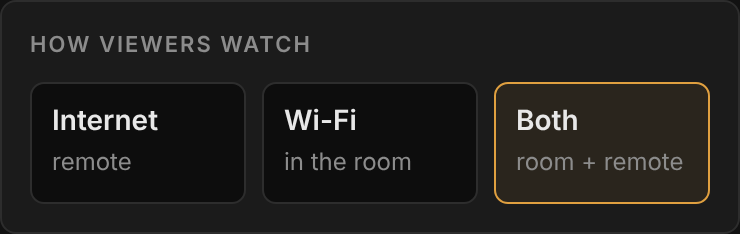

| Режим | Для кого | Как идёт сигнал | Ожидаемая задержка* |
|---|---|---|---|
| **Интернет** | клиент в другом городе | Cloudflare Tunnel (HTTPS) | ≈0,2–0,5 с на хорошей связи |
| **Wi-Fi** | все в одной комнате | WebRTC напрямую по локальной сети; интернет не нужен | ≈0,1–0,25 с |
| **Оба** | комната плюс удалённые зрители | оба способа сразу; каждый кадр кодируется один раз | как выше |

<sub>* Оценка по замерам на стенде плюс типичная задержка сети — см. [Задержка](#задержка).</sub>

Смена режима отключает зрителей только когда без этого нельзя (например, переход с «Оба» на «Wi-Fi» отключает зрителей из интернета), и программа сначала спрашивает.

<br clear="right">

### 3. Ссылки и QR-код

<table><tr>
<td width="50%" valign="top">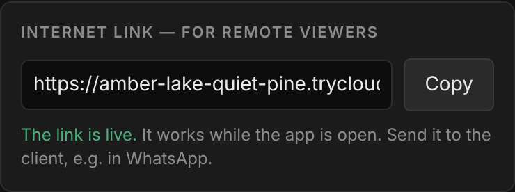<br><b>Ссылка для интернета</b> — случайный адрес <code>https://…trycloudflare.com/v/…</code>. Скопируйте и отправьте клиенту. Работает, пока открыта программа, и меняется при каждом запуске.</td>
<td width="50%" valign="top">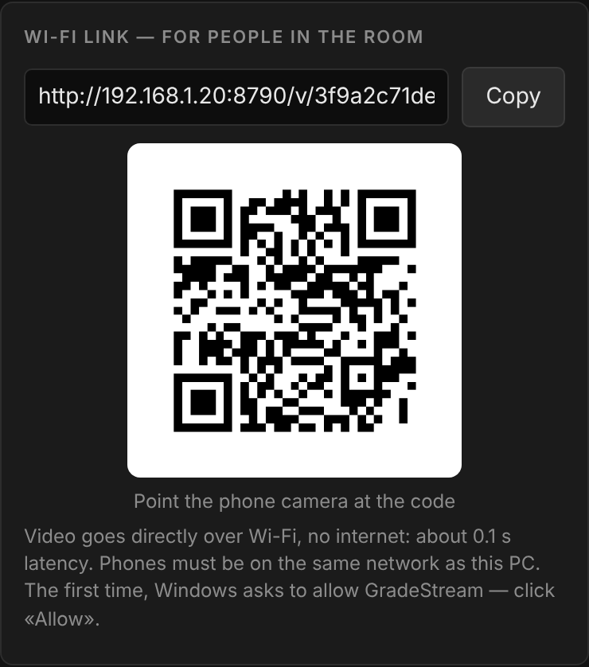<br><b>Ссылка для Wi-Fi</b> — <code>http://&lt;IP компьютера&gt;:8790/v/…</code> с QR-кодом. Если у компьютера несколько сетевых адаптеров, выберите адрес той сети Wi-Fi, к которой подключены телефоны.</td>
</tr></table>

Нажмите на QR-код, чтобы показать его на весь экран — удобно для комнаты с людьми:

<p align="center">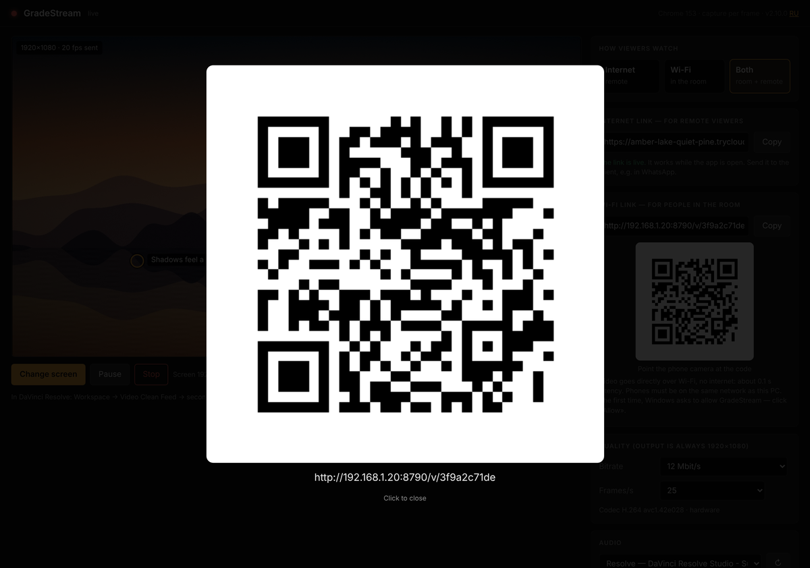</p>

### 4. 1920×1080 или 1080×1920 для вертикальных видео

Клиент получает кадр 1920×1080. Если монитор с Clean Feed в Windows стоит в **книжной** ориентации (вертикальный монтаж для Reels, Shorts, TikTok), кадр будет **1080×1920** — всё остальное работает так же: метки, их снимки, метки поверх Clean Feed, скопы. Если у монитора не 1080p, GradeStream спрашивает, как привести картинку, и запоминает ответ для этого разрешения (поменять потом — **изменить** под предпросмотром).

<p align="center">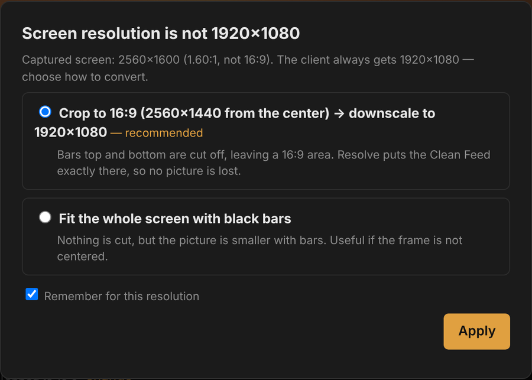</p>

| Ваш монитор | Варианты (★ рекомендуемый) |
|---|---|
| 1920×1080 | без изменений |
| 4K, 1440p и другие 16:9 | ★ уменьшить до 1920×1080 · кроп 1:1 из центра (пиксель в пиксель, для проверки зерна и шума) |
| 720p и меньше, 16:9 | ★ увеличить до 1920×1080 |
| 1920×1200 | ★ обрезать полосы по 60 px сверху и снизу (Resolve ставит туда Clean Feed 16:9 по центру) · вписать с полями |
| 2560×1600, сверхширокие и другие | ★ кроп до 16:9 из центра → масштаб до 1920×1080 · вписать с полями |
| 1080×1920 (книжная ориентация) | без изменений, вертикальный кадр |
| 2160×3840 и другие 9:16 | ★ уменьшить до 1080×1920 · кроп 1:1 из центра |
| 1200×1920 и другие вертикальные | ★ кроп до 9:16 из центра · вписать с полями |

На телефоне вертикальный кадр занимает весь экран, когда телефон держат вертикально; если повернуть телефон, кадр стоит посередине. Когда открыты скопы, кадр получает свою колонку (телефон горизонтально) или верх экрана (вертикально):

| Телефон горизонтально | Телефон вертикально |
|---|---|
| 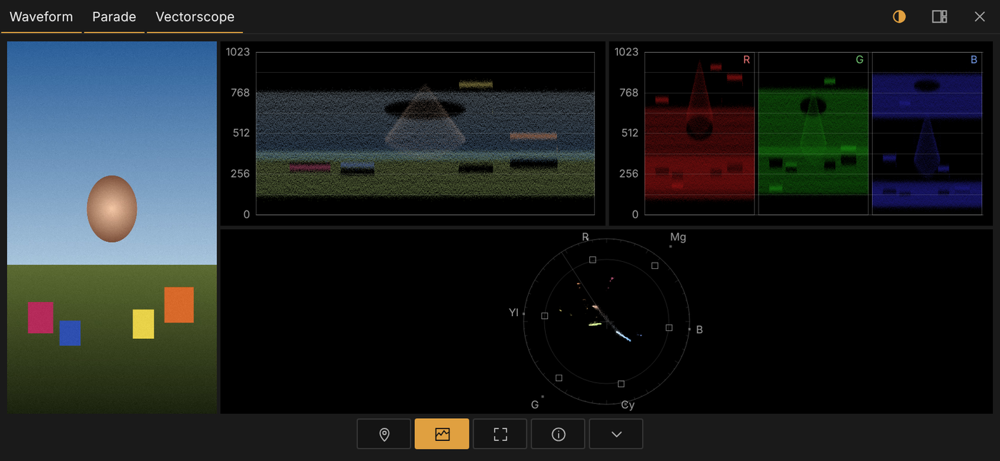 | 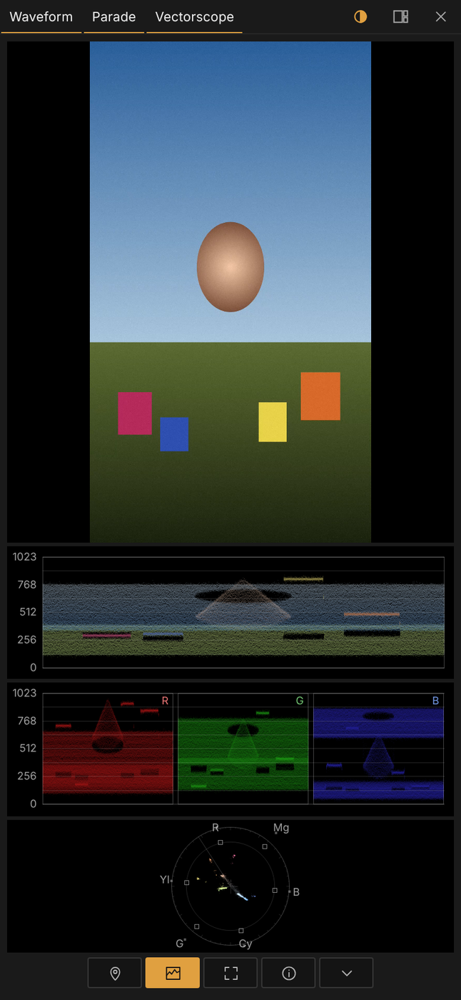 |

### 5. Качество

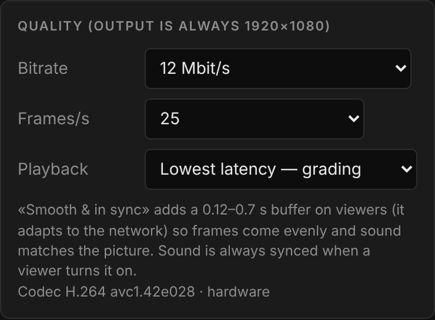

- **Битрейт** — 4 / 8 / 12 / 16 / 24 Мбит/с. Для телефона подходит 8–12; 4 — для слабой связи, 16–24 — когда важны градиенты и мелкие детали, а сеть позволяет.
- **Кадров/с** — 12 / 24 / 25 / 30 / 50 / 60. При 12 к/с каждый кадр получает примерно вдвое больше данных, чем при 25: чище тени и градиенты, пока вы крутите ручки, но движение дёрганее. Меняется на ходу.
- **Подача** — **Минимальная задержка** (по умолчанию, для цветокоррекции: кадр показывается сразу, как пришёл) или **Плавно и синхронно** (для просмотра монтажа: буфер 0,12–0,7 с, ровные кадры, звук синхронно). Если зритель включил звук, синхронизация включается всегда.
- **Скопы у клиента** — разрешены или выключены ([подробнее](#8-скопы-у-клиента)).
- Строка ниже показывает кодек и используется ли **аппаратный** кодировщик (NVENC / Quick Sync / AMF).

<br clear="right">

### 6. Звук

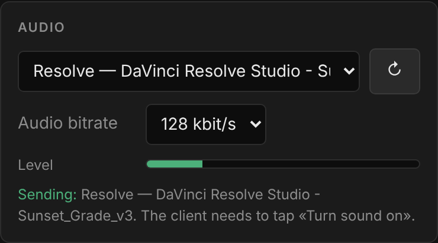

- **Без звука** — вся полоса уходит на картинку (по умолчанию).
- **Устройство вывода** — всё, что играет на устройстве вывода Windows (например, на ваших колонках).
- **Одно приложение** — только одна программа и её дочерние процессы, например только Resolve: звуки мессенджеров и браузера до клиента не доходят (Windows 10 2004+).
- **Тестовый сигнал** — бип 1 кГц в начале каждой секунды по тем же часам, что и картинка: проверьте, что звук доходит до клиента и совпадает с тем, что на экране.
- **Битрейт звука** 64 / 128 / 192 кбит/с (Opus) и индикатор уровня. Выбор запоминается; приложение после перезапуска находится заново по имени.

Клиент слышит звук после нажатия плитки звука (телефоны разрешают звук только после касания). Через интернет звук клиенту не отправляется, пока он её не нажал; по Wi-Fi звук идёт вместе с видео и просто включается.

<br clear="right">

### 7. Что видит клиент

<p align="center">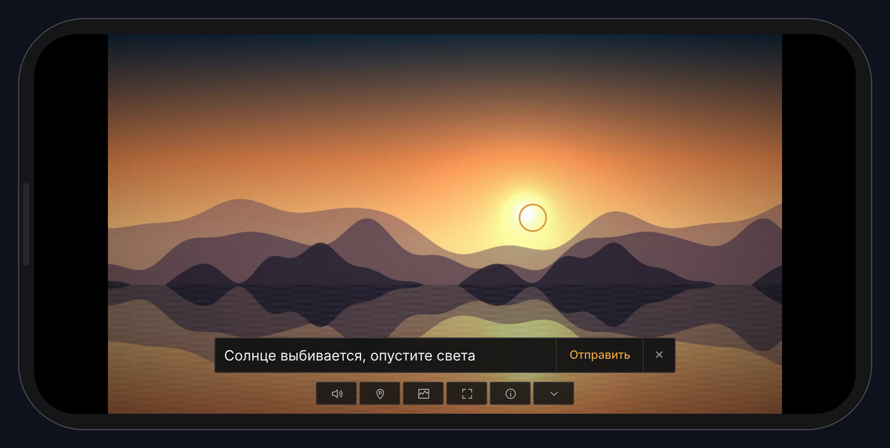</p>

У клиента один ряд маленьких плиток; включённая плитка становится оранжевой. Касание картинки прячет или возвращает плитки.

| Плитка | Что делает |
|---|---|
| **Динамик** | звук вкл / выкл (видна, только когда вы транслируете звук) |
| **Метка** | режим метки: коснуться кадра, написать комментарий в строке над плитками, **Отправить** — метка сразу приходит к вам. Момент кадра берётся в момент касания, а не когда клиент допечатал. |
| **Скопы** | Waveform, Parade, Vectorscope — [см. ниже](#8-скопы-у-клиента) (видна, если вы их разрешили) |
| **Уголки рамки** | полный экран; касание картинки возвращает плитки, поэтому метки, скопы и звук работают и в полном экране. Пока полный экран включён, плитка оранжевая — нажмите ещё раз, чтобы выйти. **На iPhone открывайте ссылку в Safari** — см. [Полный экран на iPhone](#полный-экран-на-iphone) ниже. |
| **i** | живая статистика: разрешение, к/с, битрейт (и задержка по Wi-Fi) |
| **Стрелка вниз** | прячет плитки |

Страница следует языку телефона клиента (английский или русский); названия скопов всегда по-английски. При ссылке через интернет она ещё и не даёт экрану телефона погаснуть.

#### Полный экран на iPhone

Apple не разрешает веб-странице разворачиваться на весь экран на iPhone — так можно только видео, а поверх видео во весь экран ничего нельзя показать (ни плиток, ни меток, ни скопов). Единственный способ получить настоящий полный экран **с** плитками — Safari с включённым Fullscreen API:

1. На iPhone: **Настройки → Приложения → Safari → Дополнения → Feature Flags → Fullscreen API** — включить (один раз).
2. Открыть ссылку GradeStream **в Safari**. Если ссылку нажали в WhatsApp или Telegram, она откроется во встроенном браузере мессенджера — выберите в его меню **Открыть в Safari**.
3. Нажать плитку с уголками рамки: страница займёт весь экран без адресной строки; касание картинки вызывает плитки.

| Браузер на iPhone | Что делает плитка полного экрана |
|---|---|
| Safari, Fullscreen API включён | настоящий полный экран, плитки, метки и скопы работают |
| Safari без этой настройки, Chrome, Firefox, Edge, встроенные браузеры мессенджеров | картинка занимает страницу, плитки прячутся, метки и скопы работают, но адресная строка браузера остаётся |

Chrome, Firefox и Edge на iPhone работают на движке Apple и не видят настроек Safari, поэтому полного экрана с плитками в них не бывает вообще. На Android, iPad и компьютерах ничего делать не нужно — страница разворачивается на весь экран в любом современном браузере.

### 8. Скопы у клиента

Клиент может открыть **Waveform, Parade и Vectorscope** прямо на телефоне — плитка скопов в нижнем ряду. Вы решаете, будут ли они у клиентов: **Качество → Скопы у клиента → Разрешены / Выключены** (выключение закрывает их сразу на всех телефонах). Названия скопов по-английски на обоих языках — так их знают те, кто ими пользуется.

Скопы никогда не закрывают картинку. Когда они открываются, картинка сдвигается, а экран делится на чёрные плитки на фоне 10% серого — без пустого места. Две раскладки, переключаются одним касанием:

| Картинка крупно | Скопы крупно |
|---|---|
| 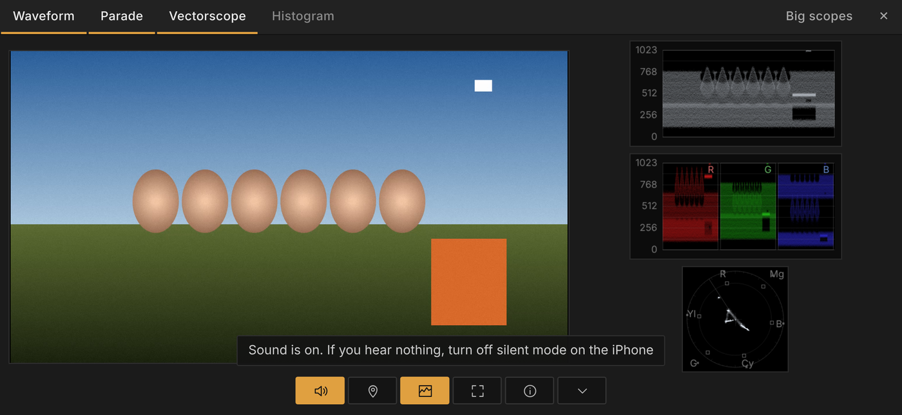 | 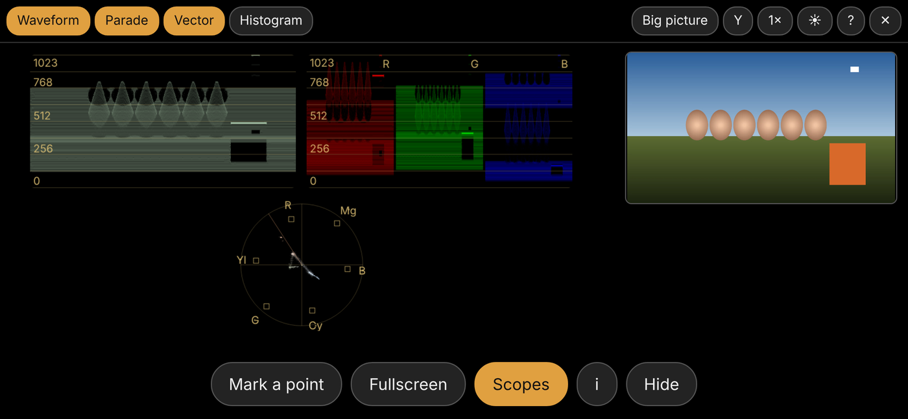 |

- **Картинка крупно** — картинка занимает около двух третей экрана, скопы рядом (под ней, если телефон вертикально).
- **Скопы крупно** — скопы на весь экран, картинка становится одной меньшей плиткой (полосой сверху, если телефон вертикально). Метки на ней ставить по-прежнему можно.
- Вкладки сверху включают и выключают каждый скоп; оставшиеся растут и занимают освободившееся место. Последний скоп выключить нельзя — для этого закройте скопы крестиком.
- **Colorize / Mono** — кнопка с названием режима справа вверху переключает все скопы сразу. Colorize (по умолчанию): waveform окрашен в цвет пикселей, как Colorize в Resolve; парад R/G/B; вектороскоп в оттенках картинки. Mono: белый след на чёрном.
- Вид как в Resolve: чёрное поле, белая шкала 0–1023 через каждые 128, тонкая сетка поверх сигнала; на вектороскопе мишени цветных полос 75%, точки 100% и линия тона кожи.

<p align="center">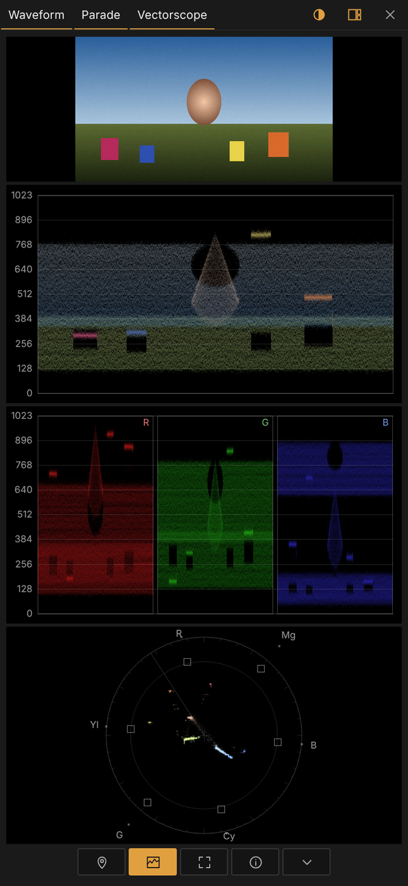</p>

**Индикация выхода за пределы.** Рамка скопа мигает красным и показывает, что не так:

- **Waveform** — `▲ 1023` / `▼ 0`: больше 0,3% картинки упирается в самый верх или низ диапазона яркости (выбитые света, провалы в чёрное);
- **Parade** — то же самое по любому из каналов R, G, B;
- **Vectorscope** — `SAT > 100%`: больше 0,3% картинки за внешним кругом (насыщенность больше 100%).

Сплошные чёрные строки и столбцы (полосы кашетирования сверху/снизу и по бокам) и размытый сжатием край рядом с ними не учитываются, поэтому широкоформатный кадр 2,39 индикацию не включает. Индикация держится одну секунду, чтобы не мигать от кадра к кадру.

<p align="center">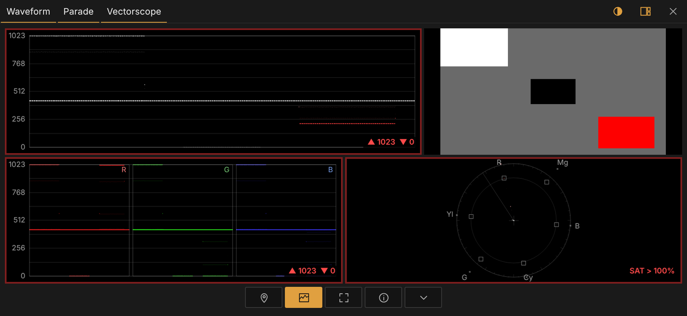</p>

**Что показывают скопы — честно.** Они считаются на телефоне по **пришедшей картинке** — 8 бит, после H.264 — по копии кадра 768×432, до 10 раз в секунду (реже на медленном телефоне). То есть они показывают то, что клиент реально получает, а не внутреннее 32-битное изображение Resolve:

- уровни, баланс и насыщенность совпадают с исходником: в автоматическом тесте (цветные полосы 75% и серая шкала, оба пути) уровни полос на waveform отличаются не больше чем на 1,5 из 255, а след на вектороскопе стоит в пределах 3 px от мишеней;
- крошечные одиночные блики могут усредниться в уменьшенной копии;
- след распределяется равномерно внутри каждой 8-битной ступени, как непрерывный сигнал в Resolve, поэтому не рассыпается на горизонтальные линии; положение следа при этом не меняется;
- решения по цвету принимайте по скопам самого Resolve; скопы у клиента — чтобы говорить об одной картинке одними инструментами.

### 9. Метки клиента

<p align="center">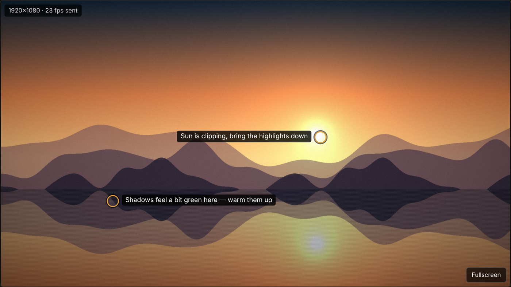</p>

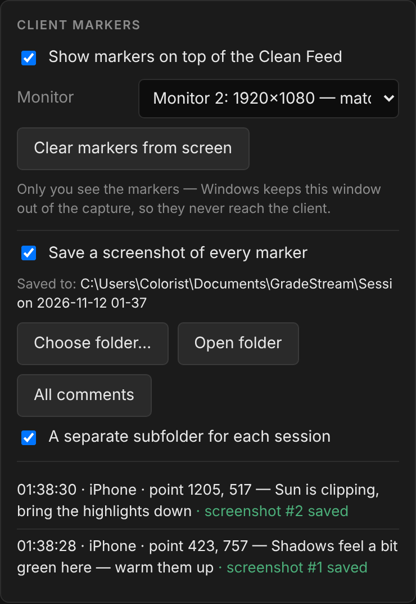

Когда клиент ставит метку, вы получаете:

- **звуковой сигнал** и метку с комментарием на предпросмотре;
- ту же метку **поверх своего монитора с Clean Feed** на 20 секунд. Окно с метками исключено из захвата экрана, поэтому клиент его в трансляции не видит. Нужный монитор выберите в поле **Монитор** (он определяется автоматически по разрешению). **Убрать метки с экрана** убирает их сразу;
- строку в списке меток со временем, устройством, координатами в пикселях и комментарием.

<br clear="right">

### 10. Снимки меток и сводка комментариев

К каждой метке сохраняется PNG **того кадра, на который клиент действительно смотрел** — программа хранит кадры за последние ~4,5 секунды и учитывает задержку каждого зрителя, — с впечатанными меткой, номером и комментарием:

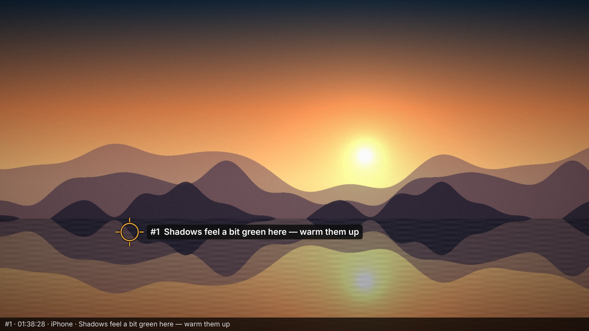

Все метки сессии собираются в `comments.html` (с галочками «Готово», страница сама обновляется каждые 10 секунд — её можно держать открытой во время сессии) и в `comments.txt`:

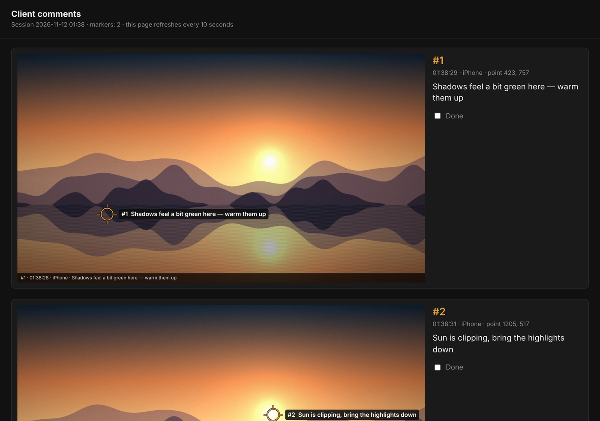

- **Выбрать папку…** — куда сохранять (запоминается; по умолчанию `Документы\GradeStream`).
- **Отдельная подпапка для каждой сессии** — включено по умолчанию; если выключить, файлы пишутся прямо в выбранную папку с датой в имени. Ничего никогда не перезаписывается.
- **Открыть папку** / **Все комментарии** — открыть папку или страницу сводки.

### 11. Зрители

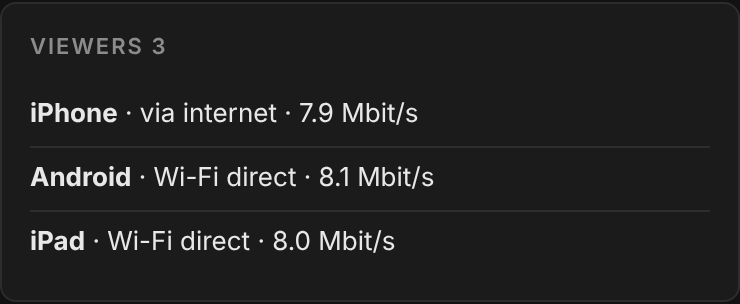

Каждый зритель показан с типом устройства, способом подключения (через интернет / Wi-Fi напрямую), битрейтом, который он реально получает, и тем, включил ли он звук. Если связь клиента не успевает, появляется предупреждение с советом снизить битрейт.

<br clear="right">

### 12. Значок в трее, язык, закрытие

- У GradeStream **свой значок на панели задач** (хотя он работает на движке Edge/Chrome) и значок **возле часов**: щелчок возвращает окно; правая кнопка — **Показать окно / Остановить трансляцию / Выход**. Подсказка показывает «в эфире, зрителей: N».
- Если свернуть окно во время трансляции, один раз появляется уведомление о том, куда делась программа.
- Закрытие окна во время трансляции требует подтверждения; **Выход** сразу останавливает трансляцию, туннель и захват звука.
- **RU/EN** в верхней строке переключает язык, не прерывая трансляцию. По умолчанию программа следует языку Windows.

## Справочник настроек

Все настройки запоминаются между запусками.

| Настройка | Где | Значения | По умолчанию |
|---|---|---|---|
| Как смотрят зрители | панель «Как смотрят зрители» | Интернет · Wi-Fi · Оба | Интернет |
| Приведение разрешения | диалог после выбора экрана; **изменить** под предпросмотром | без изменений · уменьшить · увеличить · кроп 1:1 из центра · кроп до 16:9 (9:16) · вписать с полями | рекомендуемый вариант для вашего монитора |
| Битрейт | Качество | 4 / 8 / 12 / 16 / 24 Мбит/с | 8 Мбит/с |
| Кадров в секунду | Качество | 12 / 24 / 25 / 30 / 50 / 60 | 25 |
| Подача у зрителей | Качество | Минимальная задержка · Плавно и синхронно | Минимальная задержка |
| Скопы у клиента | Качество | Разрешены · Выключены | Разрешены |
| Источник звука | Звук | нет · устройство вывода · одно приложение · тестовый сигнал | нет |
| Битрейт звука | Звук | 64 / 128 / 192 кбит/с | 128 кбит/с |
| Метки поверх Clean Feed | Метки клиента | вкл / выкл · монитор | вкл · определяется автоматически |
| Сохранять снимок каждой метки | Метки клиента | вкл / выкл | вкл |
| Папка снимков | Метки клиента → Выбрать папку… | любая папка | `Документы\GradeStream` |
| Подпапка для каждой сессии | Метки клиента | вкл / выкл | вкл |
| Адрес для Wi-Fi | ссылка для Wi-Fi (видна, если у компьютера несколько сетей) | локальные IP-адреса компьютера | основная сеть |
| Язык интерфейса | RU/EN в верхней строке | English · Русский | язык Windows |

## Как это устроено

```
┌──────────────────── ваш ПК (Windows) ─────────────────────┐
│ монитор с Clean Feed ── захват экрана (Windows Graphics    │
│                         Capture, 8-битный RGB)             │
│        ↓                                                   │
│ окно GradeStream (движок Edge/Chrome):                     │
│   кроп/масштаб → 1920×1080 / 1080×1920 → H.264 (WebCodecs, │
│   аппаратный кодировщик, если есть) ; звук → Opus          │
│        ↓                                                   │
│ GradeStream.exe — раздаёт трансляцию зрителям              │
└──────┬───────────────────────────────────────┬─────────────┘
       │ Интернет                              │ Wi-Fi
       ↓                                       ↓
 cloudflared → Cloudflare → HTTPS       WebRTC напрямую по
 (WebSocket, TCP)                       локальной сети (UDP)
       ↓                                       ↓
 телефон: декодер WebCodecs             телефон: встроенный
 → canvas                               плеер WebRTC
```

- Каждый кадр кодируется **один раз** и уходит всем зрителям по обоим путям, поэтому нагрузка почти не растёт с числом зрителей.
- Нашего сервера в интернете нет: сервер — это программа на вашем ПК. Cloudflare только делает её доступной по HTTPS-ссылке (порты на роутере открывать не нужно).
- В локальной сети страница открывается по адресу `http://<IP компьютера>:8790/...`. WebCodecs браузеры дают только по HTTPS, поэтому по Wi-Fi видео идёт через WebRTC: он работает без HTTPS и даёт самую низкую задержку.

## Технические характеристики

### Видео

| Параметр | Значение |
|---|---|
| Разрешение выхода | 1920×1080; 1080×1920, если монитор в книжной ориентации |
| Частота кадров | 12, 24, 25, 30, 50, 60 |
| Кодек | H.264. Режим «Интернет» — High Profile; режимы «Wi-Fi» и «Оба» — Constrained Baseline (гарантированно воспроизводится через WebRTC на любом телефоне) |
| Разрядность и цветовая субдискретизация | 8 бит, YCbCr 4:2:0 |
| Битрейт | 4, 8, 12, 16, 24 Мбит/с (на выбор) |
| Цветовая разметка потока | первичные цвета BT.709, матрица BT.709, **полный диапазон** (0–255), передаточная функция **sRGB** (IEC 61966-2-1) |
| Ключевые кадры | не реже чем раз в 3 с и по запросу, когда подключается зритель |
| Перегрузка | лишние кадры отбрасываются до следующего ключевого (задержка не накапливается) |

### Звук

| Параметр | Значение |
|---|---|
| Источник | устройство вывода Windows (WASAPI loopback) или одно приложение с дочерними процессами (process loopback, Windows 10 2004+) |
| Кодек | Opus, 48 кГц, стерео, 64/128/192 кбит/с |
| Телефоны без декодера Opus | несжатый PCM 24 кГц (режим «Интернет») |

### Задержка

**Замерено** (тестовый стенд, один компьютер, программный кодировщик, без реальной сети; [подробности](docs/MEASUREMENTS.md)). От отрисовки кадра до показа у зрителя, в режиме подачи по умолчанию — **Минимальная задержка** (**Плавно и синхронно** добавляет поверх свой буфер 0,12–0,7 с):

| Путь | Медиана | Разброс |
|---|---|---|
| Путь через интернет без самой сети (кодирование → сервер → WebSocket → декодирование) | 80–125 мс (по пяти прогонам) | 34–185 мс |
| Путь через Wi-Fi (кодирование → WebRTC → буфер сети → декодирование) | 150 мс | 122–173 мс |

**Не замерено**, но добавляется в реальной работе:

- захват экрана Windows — обычно 1–2 кадра (17–33 мс при 60 Гц);
- показ на экране телефона — 1–2 кадра;
- **Wi-Fi:** сама сеть добавляет несколько миллисекунд. Ожидайте примерно 0,1–0,25 с от монитора до телефона;
- **Интернет:** путь до ближайшего дата-центра Cloudflare от вас и от клиента плюс TCP. На хорошей связи ожидайте 0,2–0,5 с. На плохой мобильной сети TCP пересылает потерянные пакеты, и картинка может замереть до следующего ключевого кадра.

Цифр «от монитора до телефона клиента в другом городе» здесь нет — это мы не замеряли.

### Цвет: чему верить, а чему нет

**Замер.** Таблица из 41 патча прошла через настоящую цепочку: серая шкала 0–255, основные и дополнительные цвета на 100% и 75%, 12 патчей ColorChecker. Результат для обоих путей ([все патчи](docs/MEASUREMENTS.md)):

| | Интернет | Wi-Fi |
|---|---|---|
| Средний ΔE2000 | 0,22 | 0,22 |
| Максимальный ΔE2000 | 0,75 (циан 75%) | 0,75 |
| Нейтральность серого (макс. цветность) | 0,01 | 0,01 |
| Чёрный / белый | 0 / 255 — без сжатия диапазона | так же |

Порог заметной разницы для человека — около ΔE2000 ≈ 1,0. Остаточная ошибка — это округление при переводе RGB → 8-битный YCbCr → RGB, а не сжатие. На ровных участках H.264 на этих битрейтах почти ничего не теряет, а полный диапазон с явной цветовой разметкой не даёт декодеру ошибиться с уровнями или матрицей.

**Можно доверять:**

- **Значениям сигнала.** Значения RGB, которые Resolve отдаёт на монитор с Clean Feed, доходят до декодера телефона с ошибкой ниже порога заметности на ровных участках.
- **Соотношениям:** баланс белого, нейтральность серого, тона кожи, относительная насыщенность, разница «до/после».
- **Захвату.** Он берёт кадр до калибровочного LUT видеокарты и монитора. Поток несёт значения, которые выдаёт Resolve, а не то, как их показывает ваш монитор, — и для оценки сигнала это правильно. Ночной свет Windows и калибровочные кривые монитора в поток не попадают; LUT вьювера в самом Resolve — попадает.

**Нельзя доверять:**

1. **Экрану телефона как эталону.** Это самый большой источник расхождения — больше, чем вся передача. Телефоны не откалиброваны; True Tone, Night Shift, автояркость и энергосбережение меняют точку белого и яркость; условия просмотра у клиента могут быть любыми.
2. **Гамме.** Поток размечен как sRGB, и телефон показывает его с кривой sRGB (≈2,2), а не BT.1886 (2,4), как эталонный монитор в тёмной комнате. Поэтому тени и нижние средние тона на телефоне выглядят светлее и мягче. Так устроен показ, это не ошибка передачи.
3. **HDR и 10 битам.** Передаётся только 8-битный SDR. Если для монитора с Clean Feed в Windows включены HDR или «Автоматическое управление цветом для приложений», захваченные значения уже преобразованы — выключите это для этого монитора. 10-битное кодирование здесь ничего бы не дало: захват экрана в Windows отдаёт браузеру 8 бит на канал, а телефон показывает страницу тоже в 8 битах (проверено замером).
4. **Мелким деталям и градиентам.** 4:2:0 вдвое снижает разрешение цвета: тонкие цветные края, титры и мелкая насыщенная фактура становятся мягче. Плавные градиенты (небо, виньетки) на низком битрейте могут давать ступеньки — это 8 бит плюс сжатие, а не грейд. Зерно и шум в движении сглаживаются. На паузе картинка становится резче с каждым ключевым кадром.
5. **Масштабу.** С монитора 4K клиент видит 1080p. Для проверки деталей используйте кроп 1:1 из центра.

**Не проверено** (чтобы было ясно): аппаратные кодировщики Windows (NVENC, Quick Sync, AMF), декодирование в Safari на iPhone и в Chrome на Android, захват настоящего экрана Windows. Замер сделан в Chromium с программным кодировщиком на синтетической таблице.

**Итог.** Цвету, который доходит до телефона, можно доверять **как сигналу**: по нашим замерам ошибка ниже порога заметности. Экрану телефона нельзя доверять **как эталонному дисплею**. Для финального утверждения цвета нужен откалиброванный монитор или отрендеренный файл. GradeStream — для обсуждения правок в реальном времени, а не для финальной приёмки.

### Проверьте сами

1. Выведите в Resolve на Clean Feed серую шкалу и цветные патчи с известными значениями.
2. Попросите клиента поставить метку. GradeStream сохранит PNG ровно того, что ушло в кодировщик, — проверьте пипеткой, что значения совпадают с исходными. Так проверяется захват.
3. Сделайте снимок экрана на телефоне. Откройте его в программе с управлением цветом (например, Photoshop: «Преобразовать в профиль → sRGB») и сравните значения. Так проверяется вся цепочка, включая декодер телефона.

## Установка

1. Скачайте `GradeStream-Setup-<версия>.zip` из [Releases](https://github.com/ushtozhish/gradestream/releases/latest), распакуйте и запустите установщик.
2. Если Windows покажет «Windows защитила ваш компьютер», нажмите «Подробнее» → «Выполнить в любом случае». Установщик не подписан сертификатом разработчика.
3. Права администратора не нужны. Программа ставится в `%LOCALAPPDATA%\Programs\GradeStream` и появляется в меню «Пуск», на рабочем столе и в «Установленных приложениях», откуда её можно удалить. Новая версия ставится поверх старой.

Нужен Microsoft Edge (уже есть в Windows) или Google Chrome — GradeStream использует их движок для захвата и кодирования. Если версия слишком старая, программа скажет, что обновить.

## Быстрый старт

1. В Resolve: **Workspace → Video Clean Feed →** монитор для клиента.
2. В GradeStream выберите режим: «Интернет», «Wi-Fi» или «Оба».
3. Нажмите «Выбрать экран» → «Весь экран» → монитор с Clean Feed. Само окно GradeStream держите на другом мониторе.
4. Отправьте клиенту ссылку или покажите QR-код тем, кто в комнате.

**Режим Wi-Fi.**

- В первый раз Windows попросит разрешить GradeStream в брандмауэре — нажмите «Разрешить».
- Если сеть в Windows отмечена как «Общедоступная», программа предупредит: переключите её на «Частную».
- Гостевые сети с изоляцией клиентов (гостиницы, кафе) не подойдут.

## Безопасность и конфиденциальность

- В ссылке случайный ключ, и она перестаёт работать, когда программа закрыта. При каждом запуске создаётся новая ссылка.
- Окно управления открывается только на вашем ПК.
- **Режим «Интернет»:** поток зашифрован (HTTPS) на обоих участках, но не сквозным шифрованием — Cloudflare расшифровывает его, чтобы переслать дальше. Видео нигде не записывается и не хранится. Для материала под строгим NDA учитывайте это или используйте режим «Wi-Fi».
- Быстрые туннели Cloudflare без аккаунта работают **без гарантии доступности**. Обычно всё в порядке, но иногда туннель не поднимается или обрывается. Программа переподключается сама, но ссылка при этом меняется.
- **Режим «Wi-Fi»:** поток не покидает локальную сеть. Передача WebRTC зашифрована (DTLS-SRTP).

## Сборка из исходников

Нужны [Go 1.27+](https://go.dev/dl/) и доступ в интернет.

```powershell
# Windows
powershell -ExecutionPolicy Bypass -File build\build.ps1
```
```bash
# Linux / macOS (кросс-компиляция под Windows)
./build/build.sh
```

Скрипт скачивает официальный cloudflared, проверяет подпись Cloudflare, собирает `app/` и `installer/` и кладёт установщик в `dist/`.

| Папка | Что внутри |
|---|---|
| `app/` | программа: сервер, туннель, WebRTC, захват звука (WASAPI), метки поверх экрана, трей; страницы `web/host.html` (окно управления) и `web/view.html` (зритель) |
| `installer/` | установщик для текущего пользователя (без прав администратора), регистрация в «Установленных приложениях», ярлыки |
| `tests/` | замеры и проверки: `colortest.js` (цвет, ΔE2000), `avtest.js` (синхронность звука и картинки, ровность кадров), `scopetest.js` (точность скопов), `layouttest.js` (раскладки у клиента и переключение скопов, горизонтальный и вертикальный экран), `alarmtest.js` (индикация выхода за пределы), `fullscreentest.js` (полный экран с плитками, iPhone и остальные), `run-all.sh` (запускает всё) — GitHub Actions тоже запускает их при каждом изменении |
| `tools/mkicon.py` | создание иконки и ресурсов Windows |

## Ограничения

- Только Windows 10/11 (захват звука, метки поверх экрана и трей используют API Windows).
- Транслируется один монитор или одно окно.
- Только 8-битный SDR; выход 1920×1080 или 1080×1920 для монитора в книжной ориентации.
- Метки поверх экрана требуют Windows 10 2004+ и захвата «Весь экран». Если Resolve показывает Clean Feed в эксклюзивном полноэкранном режиме, окно с метками не может появиться поверх.
- На iPhone настоящий полный экран с плитками работает только в Safari с включённым Fullscreen API ([подробнее](#полный-экран-на-iphone)).

## Лицензия

[MIT](LICENSE). Сторонние компоненты (cloudflared — Apache 2.0, Pion WebRTC — MIT и другие) перечислены в [THIRD_PARTY_NOTICES.md](THIRD_PARTY_NOTICES.md).
